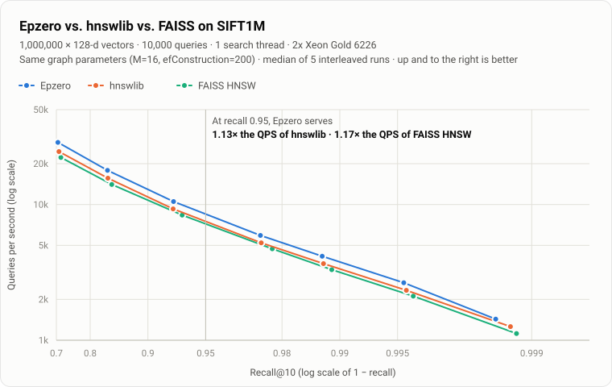
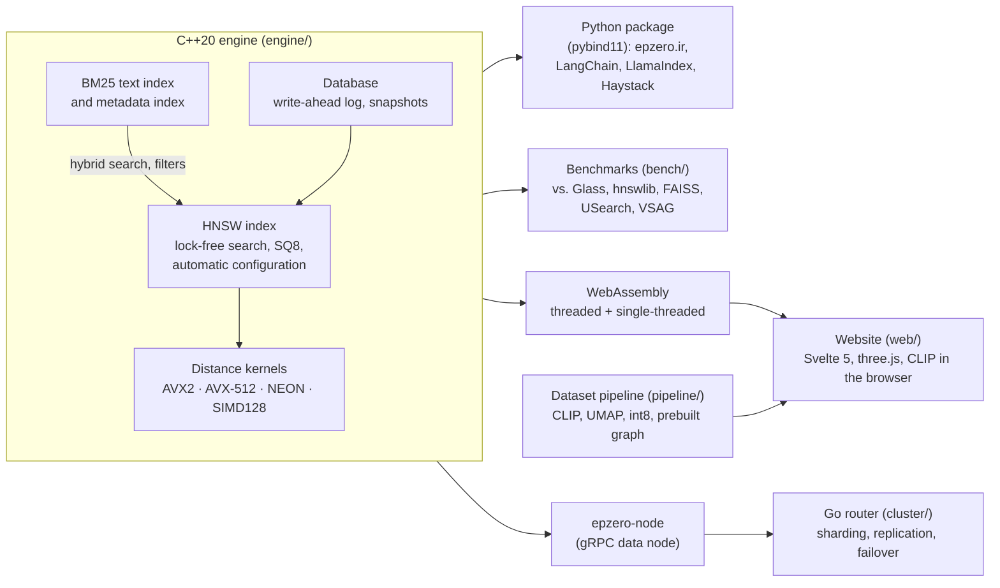
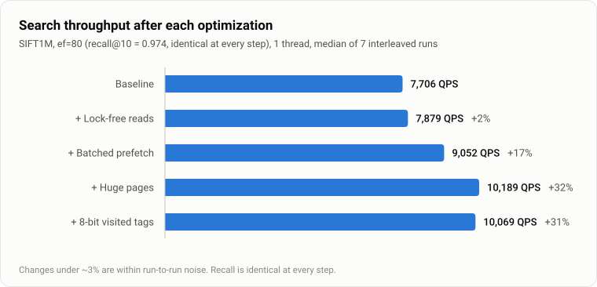

# Epzero

**[epzero.dev](https://epzero.dev/)**

A vector database built from scratch in C++20: HNSW (Hierarchical Navigable
Small World) approximate nearest-neighbor search, with hand-written SIMD kernels,
8-bit quantization, lock-free concurrent search and memory-system tuning. **It
configures itself:** `epzero.build(vectors)` chooses the compression, the graph
build and the search effort for your data and recall target, and times its
memory prefetching on your CPU (`pip install epzero`).

On dedicated servers (Georgia Tech's PACE cluster), with the same code on an
Intel Xeon Gold 6226, an AMD EPYC 7513 and an AMD Threadripper PRO 9985WX, it
answers **1.3–4.2× as many queries per second as Glass**, the fastest of the five
other libraries compared, at equal recall on GIST1M, OpenAI DBpedia embeddings and
DEEP10M, and 1.1–1.5× on GloVe-100 at recall 0.90 and above (3% behind at 0.80 on
one CPU). It builds those indexes up to 5× faster and, on the larger datasets, in
less memory. On SIFT1M at full precision it serves 1.08× hnswlib's and 1.12×
FAISS's queries per second at the same recall and scales to 10× on a 12-core
socket. On modern embeddings from the VIBE benchmark it is 1.0–1.6× Glass on text
embeddings (mxbai, Nomic) and 1.8–3.5× on LAION and ImageNet-ALIGN, where text
queries search image vectors and Glass stops short of recall 0.91–0.94. On the
older Intel Xeon it trails at recall 0.90: 0.87× on ImageNet-CLIP and 0.97–0.99×
on Yandex. [The scoreboard lists every run, losses included →](docs/scoreboard.md)

**It is built to be used.** `pip install epzero` on Linux, macOS and Windows; vector stores for
LangChain, LlamaIndex and Haystack that pass each framework's own test suite; metadata filters,
keyword and hybrid search in the engine; and `epzero.ir`, which runs retrieval experiments end to end
and scores them exactly as trec_eval does (hybrid search: nDCG@10 0.713 on BEIR SciFact).

**It also makes recall visible and keeps it on target.** Every approximate
index trades accuracy for speed, and in production nobody measures the
accuracy: it drifts with deletes, filters and new kinds of queries, and a RAG
system then answers from the wrong documents without anyone noticing. Epzero's
recall guard re-answers a small sample of real queries exactly in the
background, reports live recall with a confidence interval, and moves the
search effort to hold a target. Under drift on SIFT1M it held 0.95 recall where
a fixed setting fell to 0.948, at 6–15% less cost than over-provisioning, and its
estimates were within 0.011 of the truth (dedicated server, SIFT1M). It can also say why any given
document wasn't retrieved. [How it works and the evidence →](docs/recall-guard.md)

The same engine runs on three targets: native (benchmarks and servers),
WebAssembly (a live, in-browser demo) and a sharded, replicated cluster (C++
data nodes behind a Go router).

**[Live demo →](https://epzero.dev/)** The engine compiled to
WebAssembly (SIMD128 + threads), running entirely in your browser:
- **[Landing page](https://epzero.dev/).** The engine loads the
  photo index behind the hero and answers live queries, then a
  scroll-driven explainer builds a small HNSW index (the real engine, in
  WebAssembly) and replays a search layer by layer. Click to search it yourself.
- **[Playground](https://epzero.dev/try).** 29,825 Open Images
  photos embedded with CLIP, loaded from a prebuilt graph in ~0.1 s and shown
  as a 3D stack of HNSW layers. The vectors are stored on their principal
  axes, a block of dimensions at a time, so search starts after the first
  2 MB of 16 and **sharpens as the rest streams in**. Search by **description, uploaded photo or webcam**
  (CLIP text and image encoders run in the browser); descriptions are also matched against the
  photos' captions (**hybrid search**: BM25 keywords fused with the vectors, so "tagine" finds the
  photo titled *Tunisian Tagine Malsouka*, which CLIP alone misses). Step through the search
  hop by hop in a debugger, or race it against an exact scan. Every search is
  checked against the exact answer, e.g. *75 µs, 12/12 same results, 45×
  faster*.
  **Blend** a photo with words ("in the snow") and slide between them live;
  **tune and rebuild** the whole index with new `M` / `efConstruction` and
  compare measured recall and speed; orbit, zoom and tap through the 3D
  graph with a navigator HUD following each search. **Filter by category**
  ("dogs only") and see which strategy the engine picked; turn on the **recall
  guard** and watch it hold a recall target live; shift-click (or tap) any star
  to learn **why it is or isn't a result**. **Reset the view** (or `H`) for a
  free look: every panel slides away, leaving just the graph to explore.
  **Search your own photos**: drop a folder and CLIP embeds them in the tab
  (several encoders side by side, ~1 minute per 1,000 photos on a laptop),
  UMAP lays out their map and the engine indexes them; everything above then
  works on them, and nothing is uploaded. They can be kept in the browser for
  next time.
- **Benchmark lab.** The engine in WebAssembly generates clustered data, or
  reads a file of **your own embeddings** (`.npy`, `.fvecs`, CSV, JSON), then
  computes exact ground truth, builds the graph on every core and sweeps `ef`
  for recall against queries per second, with cosine, L2 or inner product. By
  default it **configures itself**, as `epzero.build` does, and shows each choice
  with its reason and the recall calibration promised beside what the queries got.
- **[Download](https://epzero.dev/download).** `pip install epzero`, what 0.5
  adds, copyable code for every workflow (automatic builds, upkeep, metadata
  filters, hybrid search, retrieval evaluation, LangChain, LlamaIndex, Haystack)
  and the BEIR results; the highlighted button in every page's header.
- **[Play](https://epzero.dev/play).** *Out-navigate Epzero*: hop
  from photo to photo along the real base-layer links to reach a target,
  then see the route Epzero's search took through its express layers.
- **[Cluster](https://epzero.dev/cluster).** The cluster's Go
  router, compiled to WebAssembly, runs against four simulated nodes. Kill,
  isolate or slow a node and watch the router fail over while searches keep
  their exact answers, then switch between strong and eventual reads and
  check the live history for linearizability with Porcupine.
- **[Benchmarks](https://epzero.dev/benchmarks).** Interactive
  SIFT1M charts against hnswlib and FAISS, the comparison with five libraries on
  four more datasets, the tuned results against Glass on Intel and AMD, round 8 on
  modern and text-to-image embeddings with the calibration it measured, the
  optimization log, SQ8 results, and a lab that benchmarks the engine on your own
  device.

The site works in Chrome, Edge, Firefox and Safari (16.4+), on desktop and
mobile, and offline after one visit. Browsers without WebGL get everything but
the 3D view; browsers too old for WebAssembly SIMD get a clear explanation.

> **Status:** 0.5.0 is the current release (November 2026), on PyPI for Linux, macOS
> and Windows. It adds health checks and in-place fixes after the build (recalibrate,
> requantize, query-shift detection), indexes that grow in place, metadata stored in
> the engine, LlamaIndex and Haystack integrations, Windows, English stemming, the
> `epzero.ir` retrieval-evaluation toolkit and 16-bit full vectors (opt-in). Next:
> 0.5.1 with round 9 (the older Xeon's low-recall gap), an ann-benchmarks and VIBE
> submission, and research on index drift for the CLEF LongEval lab. The cluster is
> built and tested in CI on every push; its cloud deployment is on hold. See the
> [roadmap](#roadmap).

<picture>
  <source media="(prefers-color-scheme: dark)" srcset="docs/img/sift1m-recall-qps-dark.svg">
  
</picture>

## Why

Vector search sits under semantic search, recommendations and retrieval for
LLMs, but most people only ever call it through a library. Epzero builds every
layer itself: the graph algorithm, the SIMD distance kernels, lock-free
concurrency, quantization, a crash-safe storage engine, replication with
failover, and a browser build that lets anyone watch a search happen. Each
choice is measured against the best existing libraries, and the ones that
didn't pay off are documented too.

The name is the algorithm's own path. An HNSW search starts at the **e**ntry
**p**oint on a sparse top layer, takes long hops toward the target, and descends
layer by layer to layer **zero**, where the answer is. The site's star-map
visuals and navigator HUD lean on that idea of search as navigation. (The
project was called Oryx until October 2026.)

## Highlights

- **Configures itself:** `epzero.build(vectors)` chooses 8-bit compression, whether to walk the
  graph on principal directions, the build passes, the re-rank and the beam width that reaches a
  recall target (calibrated on rows held out of the graph, or on your queries), and times memory
  prefetching on the machine. It saves those choices, with the reason for each, inside the index;
  any of them can be overridden ([how it decides](engine/include/epzero/auto.h)). On an Intel Xeon
  Gold 6226 and an AMD Threadripper PRO 9985WX it matched hand-tuned settings (level or ahead on
  GIST1M and DBpedia, 1-5% behind on GloVe-100 and DEEP10M) and held recall 0.949-0.957 against a
  0.95 target on the benchmarks' own queries ([round 7](docs/performance.md)).
- **Faster than Glass, the fastest library we compared, on the classic benchmarks and every CPU
  measured** (except GloVe-100 at recall 0.80 on the Gold, 3% behind): at equal recall on one thread,
  2.8-4.2× on GIST1M (recall 0.90-0.95), 1.6-2.7× on OpenAI DBpedia and 1.4-1.5× on DEEP10M
  (0.90-0.98), and 1.0-1.3× on GloVe-100 (0.80-0.93), on a Xeon Gold 6226 and an AMD EPYC 7513 with the
  same code. Builds are faster too, except on GloVe-100 and on DEEP10M on the Gold. These are each
  dataset's best settings, chosen on the queries they are measured on; the
  [scoreboard](docs/scoreboard.md) lists every run and every loss.
- **Modern and out-of-distribution embeddings** (VIBE's datasets, round 8, `epzero.build` with no
  settings): 1.2-1.6× Glass on AG News (mxbai, 1,024-d) and 1.0-1.2× on arXiv (Nomic, 768-d) at
  recall 0.90-0.98; on text-to-image search (LAION, ImageNet-ALIGN) 1.8-3.5× at 0.90, where Glass
  reaches at most 0.908 and 0.938 recall and Epzero 0.95-0.97 and 0.98. Builds 1.2-4.9× faster. It
  trails on the Gold at recall 0.90 on ImageNet-CLIP (0.87×) and Yandex (0.97-0.99×); round 9
  investigates ([table](#results)).
- **Stays accurate after the build** (0.5): `index.health()` reports growth since
  calibration, deleted vectors, how much the 8-bit codes have drifted and whether the principal
  directions still fit the data, with plain advice; each fix runs in place.
  `index.recalibrate(queries)` re-measures the search effort; `index.requantize()` refits the codes
  after drift (in a synthetic test with a 4 sd drift, the beam width for recall 0.95 went from 200
  back to a rebuild's 12, in half a rebuild's time); `index.check_queries(queries)` spots queries unlike the data (text against images:
  recall calibrated on the data was 0.74-0.80 for a 0.95 target, and 0.945-0.960 once recalibrated
  on the queries). Indexes grow in place as vectors are added, keeping the graph.
- **Metadata filters in the engine:** `epzero.Metadata` keeps fields per label with an inverted
  index and answers `{"year": {"$gte": 2022}, "lang": ["en", "de"]}`-style filters for a filtered
  search; the framework stores use it instead of filtering in Python.
- **LangChain, LlamaIndex and Haystack** vector stores, each passing its framework's own
  conformance suite, with filters run in the engine.
- **Retrieval evaluation** (`epzero.ir`): documents under string ids, dense, keyword and hybrid
  retrieval, TREC run files, and nDCG, MAP, recall and MRR identical to trec_eval's (tested against
  it, ties included). On BEIR with all-MiniLM-L6-v2 the dense scores reproduce the published ones
  exactly (SciFact 0.645) and hybrid reaches 0.713 on SciFact and 0.354 on NFCorpus.
- **Recall you can see and keep:** live recall estimates with confidence
  intervals from sampled exact checks, a guard that holds a recall target as
  the workload drifts, and an explanation for any miss
  ([details](docs/recall-guard.md)).
- **Filtered search that chooses its own strategy:** an exact scan of the
  allowed vectors, a graph walk that skips excluded ones, or a two-hop walk
  across them, picked per query by a cost model calibrated on a dedicated
  server. Each wins somewhere: from 39k queries/s (0.1% of vectors allowed)
  to 5k (50%), at recall 0.95 on SIFT1M.
- **Per-query search effort:** a search can stop as soon as its own answer
  settles, so easy queries finish early and hard ones search further, and the
  recall guard can steer that instead of one beam width for everything. Under
  drift on GloVe-100, where query difficulty varies widely, it held the same
  target in 13% less time (22% fewer distance computations); on SIFT1M, where it
  varies little, it is about even, so it is opt-in (dedicated server; [details](docs/recall-guard.md#per-query-effort)).
- **Hybrid search:** a BM25 keyword index beside the vector index, merged by
  reciprocal rank fusion, for the exact terms (product codes, names, error
  messages) that embeddings blur. English words are stemmed (Porter, as Lucene
  does): BM25 nDCG@10 rose from 0.660 to 0.688 on SciFact and from 0.305 to
  0.321 on NFCorpus (BEIR's Anserini baselines: 0.665 and 0.325).
- **Searches don't stop for writes:** 4,049 writes/s cost concurrent readers
  9% of their throughput, and p99 latency went from 236 to 262 µs.
- **Hardened against malformed files:** libFuzzer runs on every parser of
  untrusted bytes in CI (snapshots, graphs, the write-ahead log, text and
  metadata indexes); it found four crash bugs in the index loaders, all fixed
  and kept as regression cases. Every file format keeps a compatibility promise:
  newer releases read every file an older one wrote, tested against a real file
  from 0.4.0 ([formats](docs/file-format.md)).
- **Guarded against regressions:** CI rebuilds a reference index on every push
  and fails if recall drops or the work per query grows.
- **Ahead of hnswlib and FAISS** on SIFT1M at full precision, at every recall level: 1.08×
  hnswlib's and 1.12× FAISS's queries per second at recall 0.95 on a dedicated
  server, and the fastest 1M-vector build (24.0 s on 24 threads, against 27.8 s
  and 37.8 s). Where huge pages are opt-in, Epzero asks for them and the others
  don't, and the lead grows to 1.46× ([why](docs/performance.md#why-the-laptop-showed-a-bigger-lead-huge-pages)).
- **Near-linear multicore scaling:** lock-free reads reach 10× on the 12 cores of
  one socket, at identical recall, and 109k queries per second on a two-socket
  node with one index copy per socket (+30% over one shared copy).
- **Hand-written SIMD** for AVX2, AVX-512, NEON and WebAssembly SIMD128, picked
  at runtime; up to 10.9× faster than scalar code.
- **8-bit quantization** with exact re-ranking: +48% QPS at identical recall.
  Integer distance kernels (one VNNI instruction per 32–64 dimensions) and
  re-ranking only the best few (now 2 × k) made it up to 1.95× faster again on
  960-dimensional GIST1M (laptop; [details](docs/performance.md#what-glass-does-better-and-what-epzero-took-from-it)).
- **Crash safety proven by fault injection:** the write-ahead log survives a
  torn write at every byte offset, mid-log corruption and random `kill -9`s.
- **A replicated cluster** whose failover is tested on every push with real
  processes, a primary killed mid-traffic and zero lost writes, and whose
  `strong` reads are **checked linearizable** under crashes, partitions and
  lossy links by a deterministic simulation and Porcupine. That simulation
  found two replication bugs, both fixed ([details](docs/consistency.md)).
- **The whole engine in the browser:** 29,825 photos searched by text, photo or
  webcam on the visitor's own CPU, with every query checked against an exact
  scan.
- **A production-grade site:** Lighthouse scores 100 for accessibility, best
  practices and SEO on its pages, with a layout-shift score of 0.02 or
  less; it works offline and is tested in Chromium, Firefox and WebKit on every
  push.

## Architecture



| Directory | Contents |
|---|---|
| [`engine/`](engine) | The C++ library: HNSW, SIMD kernels, quantization, `Database` (WAL), snapshots, tests, benchmarks, Python bindings, the gRPC node server and the WebAssembly bindings |
| [`web/`](web) | The website: Svelte 5 pages, the three.js scene, Web Workers for the engine and the CLIP encoders, the service worker, and Playwright tests |
| [`cluster/`](cluster) | The Go router, its HTTP API and CLI, and the three-node failover test |
| [`proto/`](proto) | The gRPC service between the router and the nodes |
| [`pipeline/`](pipeline) | Builds the demo dataset from Open Images |
| [`bench/`](bench) | Library comparison scripts (`compete.py`), the scoreboard generator and every measured result |
| [`scripts/`](scripts) | Dataset downloads, the WebAssembly builds, and the PACE (Slurm) job scripts for each benchmark round |
| [`deploy/`](deploy) | Terraform, systemd units and a rolling deploy script for the cluster |
| [`docs/`](docs) | The performance log, the [scoreboard](docs/scoreboard.md), the research plan, design notes and charts |

**Tech stack.**

| Area | Tools |
|---|---|
| Engine | C++20 (GCC, Clang, MSVC), CMake, AVX2 / AVX-512 / NEON / WASM SIMD128 intrinsics, pybind11 + scikit-build-core |
| Integrations | LangChain, LlamaIndex, Haystack; BEIR, TREC run files, VIBE and ann-benchmarks adapters |
| Cluster | Go 1.27, gRPC, Protocol Buffers, Prometheus text metrics |
| Web | Svelte 5, TypeScript, Vite, three.js, Emscripten (pthreads, SIMD), transformers.js on ONNX Runtime Web (CLIP ViT-B/32), service worker |
| Data | PyTorch + CLIP, UMAP, Open Images V7 |
| Testing and CI | CTest, ThreadSanitizer, AddressSanitizer + UBSan, libFuzzer, pytest, Go race detector, govulncheck, Porcupine, Playwright (Chromium, Firefox, WebKit), axe-core, GitHub Actions on x86-64, ARM64 and Windows, cibuildwheel, a recall and work regression gate |
| Benchmarking | Dedicated nodes on Georgia Tech's PACE cluster (Slurm): Intel Xeon Gold 6226, AMD EPYC 7513, AMD Threadripper PRO 9985WX |
| Hosting | Cloudflare Workers (static assets at the edge, the CLIP models in R2 behind a Worker), deployed from CI; Terraform for Oracle Cloud (Ampere A1) |

## Results

**Against Glass on three CPUs** (dedicated PACE nodes, `M=16`, `efConstruction=200`, one search
thread, median of 3 interleaved rounds, 1,000 queries). Queries per second as a multiple of Glass's
at equal recall, at each dataset's recall targets; builds on every core, Epzero against Glass. The
Gold 6226 and Threadripper columns are `epzero.build` with no settings given (round 7); the EPYC
column is each dataset's hand-tuned settings (round 6), which the automatic ones matched to within
5% on the other two CPUs.

| Dataset | Recall | Gold 6226 (Cascade Lake) | Threadripper PRO 9985WX (Zen 5) | EPYC 7513 (Zen 3) |
|---|---|---|---|---|
| GIST1M (960-d) | 0.90 / 0.95 | 2.97× / 4.12× | 2.23× / 3.02× | 3.01× / 4.16× |
| DBpedia OpenAI (1536-d) | 0.90 / 0.95 / 0.98 | 1.59× / 1.82× / 2.28× | 1.94× / 2.21× / 2.68× | 1.80× / 1.98× / 2.41× |
| DEEP10M (96-d) | 0.90 / 0.95 / 0.98 | 1.40× / 1.32× / 1.39× | 1.31× / 1.29× / 1.44× | 1.42× / 1.38× / 1.51× |
| GloVe-100 | 0.80 / 0.90 / 0.93 | 0.97× / 1.08× / 1.16× | 1.29× / 1.43× / 1.52× | 1.08× / 1.25× / 1.34× |
| Build (GIST, DBpedia, DEEP, GloVe) | | 101/190, 166/245, 444/495, 60/56 s | 28/151, 49/224, 260/517, 28/28 s | 62/363, 225/510, 458/752, 118/85 s |

Glass stops below recall 0.98 on GIST1M (0.967). The automatic configuration held recall 0.949–0.957
on the real queries against its 0.95 target in all eight runs. Epzero's indexes take less memory than
Glass's on GIST1M, DBpedia and DEEP10M (4.0 against 5.2 GB, 6.3 against 8.4, 7.0 against 8.7) and
the same on GloVe-100. Raw results: [`bench/results/pace/`](bench/results/pace/); every run, with
hnswlib, FAISS, USearch and VSAG too: the [scoreboard](docs/scoreboard.md).

**Modern embeddings and out-of-distribution queries** (round 8: VIBE's datasets, `epzero.build` with no
settings, the same setup). Queries per second as a multiple of Glass's at recall 0.90 / 0.95 / 0.98:

| Dataset | Queries | Threadripper PRO 9985WX | Gold 6226 |
|---|---|---|---|
| AG News, mxbai, 1024-d | like the data | 1.41× / 1.57× / 1.63× | 1.21× / 1.31× / 1.38× |
| arXiv, Nomic, 768-d | like the data | 1.04× / 1.17× / 1.17× | 1.07× / 1.18× / 1.15× |
| ImageNet, CLIP, 512-d | like the data | 0.97× / 1.09× / 1.37× | 0.87× / 0.97× / 1.13× |
| LAION, CLIP, 512-d | text against images | 3.18× at 0.90 (Glass stops at 0.908) | 2.74× (Glass stops at 0.907) |
| ImageNet, ALIGN, 640-d | text against images | 2.30× at 0.90 (Glass stops at 0.938) | 1.80× (Glass stops at 0.938) |
| Yandex, 200-d | text against images | 1.18× / 1.47× / 1.72× | 0.99× / 1.08× / 1.29× |

Epzero built every index faster (22 s against 108 s on AG News on the Threadripper; 1.3-1.6× on the
Gold). Where queries are like the data, recall at the calibrated beam width was 0.944-0.961 for a 0.95
target on both machines. Where text searches images it was 0.74-0.80, as rows of the data are easier
queries than text: `check_queries` detects that (the queries sit 2.2-2.3× farther from their nearest
neighbours than rows do), and calibrating on a sample of the queries gave 0.945-0.960 (`epzero-auto-ood`).
The losses are on the Gold at low recall; at equal beam width Epzero's recall is higher there but its
speed per step lower, on that CPU only (on the laptop Epzero is 1.63× Glass on Yandex at 0.90), and a
kernel A/B run (round 9) is measuring why.

**SIFT1M** (1M × 128-dim, 10k queries, official ground truth), `M=16`,
`efConstruction=200`, 1 search thread, median of 3 runs.

**Reference server:** a dedicated node (Slurm `--exclusive`) with 2 × Intel Xeon
Gold 6226 (AVX-512, clock fixed at 2.7 GHz), GCC 13, search pinned to one socket
and its memory. Runs agree within 0.5%. Job scripts: [`scripts/pace/`](scripts/pace/).

| ef  | recall@10 | QPS    | p50 latency | p99 latency | distances/query | vs. brute force |
|-----|-----------|--------|-------------|-------------|-----------------|-----------------|
| 10  | 0.7052    | 28,541 | 34 µs       | 59 µs       | 390             | 1,175×          |
| 40  | 0.9266    | 10,520 | 96 µs       | 132 µs      | 883             | 433×            |
| 80  | 0.9743    | 5,912  | 175 µs      | 220 µs      | 1,484           | 243×            |
| 200 | 0.9954    | 2,651  | 392 µs      | 485 µs      | 3,085           | 109×            |
| 400 | 0.9985    | 1,432  | 727 µs      | 911 µs      | 5,394           | 59×             |

- **Against other libraries:** 1.06–1.08× hnswlib's and 1.12–1.18× FAISS's QPS
  at equal recall, from recall 0.80 to 0.995 (chart below).
- **Against the field, shipped defaults:** on GIST1M, GloVe-100, DBpedia OpenAI embeddings and
  DEEP10M, plain 8-bit Epzero (an earlier run, before the walk on principal directions and the
  second build pass) is ahead of VSAG, FAISS, hnswlib and USearch on every one
  ([table](docs/performance.md#against-the-field-four-more-datasets)); the table above is the
  comparison with Glass since.
- **Build:** 1M vectors in 22.7 s on 24 threads. The index takes 765 MiB.
- **Threads:** 59,636 QPS on 12 threads of one socket (10.0×) and 83,746 on all
  24 (14.0×), at recall 0.974. Crossing sockets costs about 19%; one index copy
  per socket avoids it, reaching 109,186 QPS on the node ([details](docs/performance.md#thread-scaling)).

**Development laptop:** Intel i5-13420H (AVX2), WSL2 Ubuntu 24.04, GCC 13. Its
higher clock (up to ~4.5 GHz) makes single-thread search about 1.8× faster;
per clock cycle the two machines are within about 10%.

| ef  | recall@10 | QPS    | p50 latency | p99 latency | distances/query | vs. brute force |
|-----|-----------|--------|-------------|-------------|-----------------|-----------------|
| 10  | 0.7064    | 47,367 | 20 µs       | 55 µs       | 391             | 1,215×          |
| 40  | 0.9265    | 18,672 | 51 µs       | 113 µs      | 884             | 479×            |
| 80  | 0.9744    | 10,477 | 94 µs       | 208 µs      | 1,484           | 269×            |
| 200 | 0.9955    | 4,718  | 210 µs      | 413 µs      | 3,086           | 121×            |
| 400 | 0.9986    | 2,529  | 396 µs      | 697 µs      | 5,396           | 65×             |

- **Build:** 1M vectors in 42.9 s on 12 threads. It loads from a snapshot in 0.3 s.
- **Library comparison:** all three libraries run in one process with
  interleaved rounds. Methodology, raw data and the huge-pages analysis are in
  [docs/performance.md](docs/performance.md).

<picture>
  <source media="(prefers-color-scheme: dark)" srcset="docs/img/optimizations-dark.svg">
  
</picture>

Profiling showed search is memory-latency bound, so the optimizations target
the memory system. The [performance log](docs/performance.md) covers each
change, including the ones that were measured, didn't help and were removed
(graph reordering, early abandoning, LTO/PGO, and RaBitQ in memory). The
story, for a general audience: [Vector search is a memory problem](docs/blog/vector-search-is-a-memory-problem.md).

**Distance kernels.** Nanoseconds per call, L1-resident data:

| dim | L2 scalar | L2 AVX2 | speedup | IP scalar | IP AVX2 | speedup |
|-----|-----------|---------|---------|-----------|---------|---------|
| 128 | 36.7      | 5.2     | 7.0×    | 35.7      | 4.5     | 8.0×    |
| 384 | 140.6     | 17.5    | 8.1×    | 135.8     | 12.5    | 10.9×   |
| 960 | 412.7     | 48.7    | 8.5×    | 402.8     | 38.6    | 10.4×   |

The speedup is higher than the 8-lane width because the scalar loop is limited
by a serial dependency chain, while the SIMD kernels use two independent FMA
accumulators.

## Engine design

- **Memory layout.** Layer 0 is one contiguous block, aligned to and backed by
  2 MiB transparent huge pages. Each node's vector sits next to its neighbor
  list. Upper layers (about 1/M of the nodes) are stored separately, per node.
- **Search.** Greedy descent through the upper layers, then a beam search of
  width `ef` on layer 0. For each expanded node, unvisited neighbors are
  filtered first and all their vectors prefetched, so up to 32 cache misses
  overlap instead of running one after another.
- **Neighbor selection.** Uses the diversity heuristic from the HNSW paper
  (Algorithm 4), so links point in different directions and the graph stays
  navigable across clusters.
- **Visited set.** One bit per node from a pool: 128 KiB for 1M nodes, so it
  stays in L2 (the byte-per-node version missed L2 on a share of its checks,
  ~8% of GloVe-100 search time). Clearing touches only the words this search
  marked, and nothing is allocated per query in steady state.
- **SIMD dispatch.** Each ISA (AVX2, AVX-512, NEON) is compiled in its own
  translation unit and picked at runtime by CPU detection. On the first AVX-512
  Xeons (Skylake-SP, Cascade Lake) 8-bit search uses the AVX2 integer kernel,
  61–73% faster there on 96–100-dimension data. `EPZERO_SIMD=scalar` forces a
  level, e.g. for A/B benchmarks.
- **Concurrency.** Search is lock-free: neighbor-list slots are atomics written
  with release stores and read with acquire loads, so a reader that sees a node
  id also sees that node's vector. Writers are serialized per node, and a
  thread never holds two node locks at once, so lock-order deadlocks are
  impossible. ThreadSanitizer checks this with 8 writers and a concurrent
  reader.
- **Tracing.** Searches can optionally record every hop (layer, from, to,
  distance, accepted). This feeds the 3D visualizer and costs nothing when
  disabled.
- **8-bit scalar quantization (SQ8).** Nodes are stored as uint8 codes with
  per-dimension scales, scored against the float query by asymmetric distance
  (a single uint8×float dot product), then re-ranked exactly. On SIFT1M this
  gives **+48% QPS at identical recall**, or 58% less memory without the float
  vectors. See the [performance log](docs/performance.md#8-bit-scalar-quantization-sq8).
- **Deletes.** Tombstones that keep routing searches but are never returned or
  linked to again; `compacted()` rebuilds the index without them. Five cycles
  of deleting and re-inserting 10% of SIFT1M cost 0.5 points of recall and 26%
  of throughput; a 35 s compaction restores both.
- **Durability.** `Database` adds a write-ahead log: CRC32C-framed records,
  fsync per write or group commit, and atomic checkpoints (the snapshot is
  written, fsynced and renamed before `CHECKPOINT` switches to it). Recovery
  replays newer records and truncates a torn tail. Tests cut the last record
  at every byte offset, corrupt records in the middle of the log, and
  `kill -9` a writer process at random moments; every acknowledged write
  survives.
- **Persistence.** A versioned binary snapshot format that doesn't depend on
  the in-memory layout. Every link is validated on load (it must name a node
  that exists on that link's layer), headers are checked against the file size
  before anything is allocated, and loading can be capped by memory. Fuzzing in
  CI keeps it that way.
- **Filtered search.** A filter is compiled once against the index (a bitset
  plus the allowed slots) and reused by every query. Each query then picks a
  strategy from the filter's selectivity and the beam width: score the allowed
  vectors directly when few pass, walk the graph keeping only allowed results
  when a quarter or more pass, and in between walk only allowed nodes,
  stepping past an excluded neighbour to its own neighbours (the idea behind
  ACORN) so the walk stays connected. Below 1.5% that walk can't reach the
  target recall, so Auto weighs a scan against the plain walk by estimated
  cost. The thresholds come from measuring every strategy at 12 selectivities
  on a dedicated server (`bench/results/pace/gold6226/sift1m-filter.json`).
  Re-measured there against the earlier fixed thresholds: filters allowing
  0.5–1% of the vectors went from recall as low as 0.34 to 1.000 at every
  beam width, 30% filters got 24–36% faster, and exact scans no longer slow
  down as the beam widens (38.6k queries/s at 0.1%, was 11k at `ef` 320).
- **Recall monitoring and control.** See [docs/recall-guard.md](docs/recall-guard.md).
- **Automatic configuration** ([`auto.h`](engine/include/epzero/auto.h)). From the data: 8-bit
  codes; a walk on principal directions at 256 dimensions or more when 80% of the variance fits in
  a quarter of them; the build passes; the re-rank; and the beam width that reaches the recall
  target, calibrated on rows held out of the graph until calibration is done (rows already in the
  graph are linked to their own neighbours, which made GloVe look like 0.95 when it was 0.87). From
  the machine: prefetching, timed per CPU. The choices and the reason for each are saved in the
  index file (an `IndexProfile`, format v5), and `search()`, `hybrid_search()`, `explain()` and the
  recall guard use them by default. Calibration never settles below k (a smaller beam is measured as
  k, so it would run unmeasured for smaller k).
- **Walking on principal directions** (`nav_dim`). For long embeddings the graph walk scores 8-bit
  codes of the top principal directions (96 of GIST1M's 960, 288 of OpenAI's 1,536) instead of every
  dimension, and the final candidates are re-ranked with the full vectors. The query is projected on
  the integer kernel. The directions come from a blocked subspace iteration with Cholesky QR: deciding
  how many to keep takes under a second at 200,000 × 960 on a laptop, and training them 1.5 s.
- **A second build pass and an early re-rank stop.** After the build every node searches the
  finished graph and reconnects (`refine_links`), as its first neighbours were chosen from a sparser
  graph; free link slots then go to two-hop neighbours. The re-rank scores candidates in blocks and
  stops once the rest, judged by this query's own gap between estimated and exact distances, can't
  reach the top k.
- **Prefetching tuned per CPU.** How many neighbours ahead, and how many cache lines of each, is timed
  on the machine: fetching a whole record was worth 1.6–1.7× on a Cascade Lake Xeon and nothing on a
  laptop, on identical code. Index memory is zeroed on every core, so on many-socket servers it is
  spread across NUMA nodes instead of sitting on one.
- **16-bit full vectors** (`half_vectors`, 0.5). The full-precision copy kept for the build
  and the re-rank can be stored as IEEE half floats: about half the index's memory, with F16C and NEON
  kernels. It cost up to 17% of the speed on GIST1M and 0.003–0.004 recall on OpenAI embeddings in
  our measurements, so it is only ever opt-in. Where the full vectors live is resolved once per query,
  which also made full-precision search 4–9% faster.
- **Growth in place** (0.5). `add()` past capacity copies the nodes into larger blocks (at least
  doubling) and keeps the graph, so stores that rebuilt themselves on every fill no longer do: loading
  40,000 documents into the LangChain store in batches of 100 went from 6.0 s to 3.4 s. Searches on
  other threads wait for the copy, which moves the index's memory.
- **Drift in the 8-bit codes** (0.5). Codes are fitted to the vectors' ranges at build time; later
  vectors outside them are clipped. `code_error` is the share of the variance the codes miss (about
  1e-4 from rounding alone), `health()` advises `requantize()` above 0.01, and `requantize()` refits the
  ranges on the live vectors, re-encodes every node in place and reconnects the graph, as the links
  chosen on clipped codes are most of the damage.
- **Metadata** (`MetadataIndex`, 0.5). Typed fields per label (str, int, float, bool), an inverted
  index per field and sorted numeric values, so equality, set and range filters cost the matching
  labels rather than a scan; the result compiles into the search's filter. Saved in its own format.
- **Keyword search** (`TextIndex`). Okapi BM25 over an inverted index, with Lucene's never-negative idf;
  tokens are lowercased runs of letters and digits, UTF-8 kept whole, and English words reduced by
  the Porter stemmer (the reference algorithm, which agrees with NLTK's on all 39,011 words of
  SciFact's and NFCorpus's vocabularies). Removed documents are skipped and compacted once they are
  the majority.
- **Portable.** The same sources build with GCC, Clang and MSVC; a thin platform layer covers
  atomics, prefetch, aligned allocation, CPU detection and the write-ahead log's file I/O on Windows.

## Python

```bash
pip install epzero                 # wheels for Linux, macOS and Windows, Python 3.10-3.13
pip install "epzero[langchain]"    # plus the LangChain vector store ([llamaindex], [haystack] likewise)
pip install ./engine               # or build from this repository
```

```python
import numpy as np, epzero

# Configured for the data and this machine; search() then uses the calibrated settings
index = epzero.build(vectors, metric="cosine", recall=0.95)
labels, distances = index.search(queries, k=10)
print(index.plan)                               # every setting and why; pass any to override:
index = epzero.build(vectors, metric="cosine", nav_dim=0, M=32, queries=sample_queries)

# After the build (0.5): what it needs, and each fix in place
print(index.health())                           # growth, deleted share, code drift, fit of the directions, advice
print(index.check_queries(sample_queries))      # do the queries look like the data?
index.recalibrate(sample_queries)               # re-measure the beam width on real queries
index.requantize()                              # refit the 8-bit codes after the data drifted
index.add(more_vectors)                         # grows in place past its capacity

# Metadata, filtered in the engine
meta = epzero.Metadata()
meta.set_many(labels, [{"lang": "en", "year": 2024}, ...])
hits, _ = index.search(queries, k=10, filter=index.filter(meta.select({"year": {"$gte": 2022}})))

# Retrieval experiments, scored as trec_eval scores them
from epzero import ir
corpus, queries_by_id, qrels = ir.load_beir("scifact")
collection = ir.Collection.build(list(corpus), doc_vectors, texts=list(corpus.values()), metric="cosine")
run = collection.retrieve(list(queries_by_id), vectors=query_vectors, texts=list(queries_by_id.values()), mode="hybrid")
print(ir.evaluate(run, qrels)); ir.write_run(run, "run.txt", tag="epzero-hybrid")

# Or by hand
index = epzero.Index(dim=128, metric="l2", max_elements=1_000_000, M=16, ef_construction=200)
index.add(vectors, threads=12)                  # labels default to 0..n-1
labels, distances = index.search(queries, k=10, ef=80, threads=1)
trace = index.trace(queries[0], k=10, ef=80)    # every hop, for visualization
index.save("sift.epzero"); index = epzero.Index.load("sift.epzero")

# 8-bit quantization: train on a sample, then add as usual
sq8 = epzero.Index(dim=128, quantization="sq8")
sq8.train(vectors[:100_000]); sq8.add(vectors, threads=12)

# Filtered search: a compiled filter is reused across queries
dogs = index.filter(dog_labels)                  # epzero.Filter: dogs.allowed, dogs.selectivity
labels, _ = index.search(queries, k=10, ef=80, filter=dogs)

# Recall you can see and keep
guard = epzero.RecallGuard(index, target=0.95, sample_rate=0.01, reference_ef=1024)
labels, _ = guard.search(queries, k=10)
print(guard.report())                           # per segment: ef, recall estimate, 95% interval
print(index.explain(queries[0], k=10, label=4217, ef=80))   # why it was or wasn't returned

# Durable collection with a write-ahead log and crash recovery
db = epzero.Database.open("./vectors.db", dim=128, sync="always")
db.upsert(vectors[:1000], labels=ids)           # one log write + fsync per batch
db.remove(42)
print(db.recovery())                            # what the last open() replayed or truncated
```

Batch calls release the GIL and run on C++ threads.

**LangChain.** `epzero.langchain.EpzeroVectorStore` is a LangChain vector store: add texts or
documents, search by similarity (with scores) or maximal marginal relevance, filter on metadata
(compiled into an Epzero filter, so the engine picks its filtered-search strategy), delete and
replace by id, and save and load a folder. It passes LangChain's standard vector-store
conformance suite (`langchain-tests`) in CI, sync and async; that suite also found a real engine
bug (new vectors were unreachable after every existing one had been deleted), now fixed.

```python
from epzero.langchain import EpzeroVectorStore

store = EpzeroVectorStore.from_texts(texts, embeddings, metadatas=metadatas)
docs = store.similarity_search("reset my password", k=4, filter={"source": "faq"})
retriever = store.as_retriever(search_kwargs={"k": 8})
```

**LlamaIndex and Haystack** (0.5). `epzero.llamaindex.EpzeroVectorStore` keeps nodes with their text
and metadata, runs LlamaIndex's metadata filters (`==`, `!=`, ranges, `in`, `nin`, AND and OR) in the
engine, deletes by reference document and persists to a folder. `epzero.haystack` has a
`DocumentStore` and an embedding retriever for pipelines, with Haystack's filter syntax run in the
engine wherever that gives exactly Haystack's answer. Each passes its framework's own test suite in
CI. [Four executed notebooks](examples/) show them, with a quick start and retrieval evaluation on
BEIR.

## WebAssembly

The same C++ core compiles to WebAssembly with a SIMD128 kernel as one more
dispatch level. Two modules are shipped:
- a **threaded** build, which runs builds and exact search on every core via
  Web Workers sharing memory;
- a **single-threaded** fallback, for pages that aren't cross-origin isolated.

In production Cloudflare sends the isolation and security headers
([`web/public/_headers`](web/public/_headers)); on a host that can't, a service
worker adds them (recovering by itself after a hard refresh, which bypasses it).
The same worker caches the site for offline use. The page also sets a Content Security Policy: only the
site's own code runs, with no `eval` (the bindings are built with
`-sDYNAMIC_EXECUTION=0`) and one inline script, the theme bootstrap, allowed by
a hash computed at build time. The whole C++ test suite also runs as
WebAssembly under Node in CI.

```bash
source emsdk/emsdk_env.sh
scripts/build_wasm.sh                 # -> web/public/wasm/{mt,st}
cd web && npm install && npm run dev  # http://localhost:5173/
npx playwright test                   # every end-to-end suite (see below)
```

The end-to-end suites run on every push: every page in Chromium (desktop
and touch phone, both themes), the core journeys in Firefox and WebKit, an
automated WCAG 2.1 AA audit (axe-core), the webcam path and every camera error,
offline use, a browser without WebGL, one without WebAssembly SIMD, and a
server that sends no isolation headers (the service worker's fallback). Deploying
to Cloudflare is described in [`web/DEPLOY.md`](web/DEPLOY.md).

The engine and both CLIP encoders run in Web Workers, so the page never blocks
on a search, an encode or an index rebuild. Other details of the site:
- **Fast first load.** Data files download in parallel and are read straight
  from the cache on repeat visits; the models load only once the index is
  ready, and are warmed in the background only on capable devices.
- **No layout shift.** Web fonts fall back to size-matched local fonts, and
  every live element (loading status, results sheet, debugger) reserves its
  space.
- **Machines without a GPU.** When WebGL runs on the CPU, the 3D scene detects
  it and switches to a calm mode that draws only when something changes, so
  the page stays responsive. Frame cost is measured everywhere, and quality
  steps down on slow GPUs.
- **Accessible.** WCAG 2.1 AA colour contrast in both themes, keyboard
  shortcuts (`?` lists them), reduced-motion support and screen-reader labels.

## Demo dataset

[`pipeline/build_dataset.py`](pipeline/build_dataset.py) builds the
explorer's data. It takes the Open Images V7 validation photos that are still
online (29,825 of 35,479), embeds them with CLIP ViT-B/32 on the GPU (92 s on
an RTX 4050), lays them out in 2-D with UMAP, and exports compact binaries:
- **int8 vectors** with per-dimension scales: 15 MB instead of 61 MB, with
  recall@10 of 0.994 against float vectors;
- a 16-bit layout;
- metadata with each photo's author, license and source link;
- a **prebuilt HNSW graph** (links only, 1.3 MB), so browsers load the index
  in ~0.1 s instead of building it; `web/scripts/build-graph.sh` regenerates it.

Photos are CC BY 2.0 and hotlinked from Flickr with attribution, and labels
are CC BY 4.0. (Unsplash Lite was evaluated and rejected: its terms forbid
publishing any portion of the data.)

```bash
pip install torch transformers umap-learn pillow
python pipeline/build_dataset.py --work data/openimages --out web/public/data/openimages
```

## Cluster

`cluster/` holds the distributed version: C++ data nodes (`epzero-node`, gRPC,
each with its own write-ahead log) and a Go router in front of them.

- **Sharding and replication.** Each shard has a primary and a backup on
  different nodes. Writes go to the primary, which forwards them synchronously
  to an in-sync backup before acknowledging (the reply says if it couldn't:
  `replicated: false`); epochs act as fencing tokens so a demoted primary
  can't accept writes.
- **Many routers, one leader.** With `-etcd`, routers share the shard map through etcd: all
  of them serve traffic, and an elected leader fails shards over, with every map change a
  compare-and-swap fenced by its election key. Without etcd a single router keeps the map in
  a local file.
- **Read consistency.** `strong` reads only primaries and is linearizable;
  `eventual` also reads in-sync backups, hedged, for lower tail latency.
  [What each guarantees, and how it is tested →](docs/consistency.md)
- **Failover and recovery.** The router health-checks every node, promotes the
  backup when a primary stops answering, and catches a returning node up from
  its peer (log records, or a snapshot when it's too far behind).
- **Queries.** Fanned out to every shard with hedged requests (the other copy
  is asked if the first is slow), then the top-k is merged.
- **API.** `POST /v1/search` is open; `upsert`, `remove` and the chaos
  `crash` endpoint need a bearer token, compared in constant time. Request
  bodies are size-limited, vectors are validated, and the server has read,
  write and idle timeouts. `GET /metrics` serves Prometheus metrics.

```bash
cmake --build build --target epzero_node
cd cluster && EPZERO_NODE_BIN=../build/epzero-node go test -race -tags integration ./...
```

CI runs that test on every push: three real nodes, a primary killed mid-traffic,
failover, recovery, and a check that no acknowledged write was lost. It also runs
`cluster/sim`: the same router against simulated nodes on a virtual clock
(`testing/synctest`), with crashes, partitions and lossy links, and checks the
read/write history with [Porcupine](https://github.com/anishathalye/porcupine).
The site's cluster page is that simulation, compiled to WebAssembly
(`scripts/build_sim_wasm.sh`). It also
checks formatting and scans for known vulnerabilities reachable from the code.
`deploy/` has the Terraform (Oracle Cloud Always Free, Ampere A1), systemd
units and a rolling-restart deploy script; credentials stay outside the
repository.

## Build and test

Linux, macOS or WSL2, CMake ≥ 3.20, GCC ≥ 13 or Clang ≥ 17; Windows with
MSVC (Visual Studio 2022) for the engine and the Python package; Go ≥ 1.27 for
the cluster; Node ≥ 22 for the site.

```bash
cmake -S engine -B build -G Ninja
cmake --build build
ctest --test-dir build --output-on-failure

build/bench_distance
build/bench_recall --synthetic --n 100000

scripts/download_sift1m.sh
build/bench_recall --base data/sift/sift_base.fvecs --query data/sift/sift_query.fvecs \
                   --gt data/sift/sift_groundtruth.ivecs --queries 10000
python bench/compare_libs.py --data data/sift --cache data/indexes --out bench/results/sift1m-compare.json
```

Sanitizers: `-DEPZERO_SANITIZE=thread` or `-DEPZERO_SANITIZE=address,undefined`.
Fuzzing (Clang): `-DEPZERO_BUILD_FUZZ=ON` builds libFuzzer targets for snapshot
loading, graph import, write-ahead-log recovery, the text index and the metadata index. CI runs GCC
and Clang on x86-64, GCC on AArch64 (NEON), MSVC on Windows, both sanitizer configurations, a minute
of fuzzing per target plus every past finding, the regression gate on recall and work per query, the
Python tests (with the LangChain, LlamaIndex and Haystack suites), and the test suite as WebAssembly
under Node. [CONTRIBUTING.md](CONTRIBUTING.md) explains how to propose a change and measure it.

Against other libraries: `bench/compete.py` (Epzero, `epzero-auto`, hnswlib, FAISS, USearch, VSAG
and Glass on any ann-benchmarks dataset, interleaved in one process) and `bench/scoreboard.py`, which
turns its results into [`docs/scoreboard.md`](docs/scoreboard.md).

More benchmarks: `bench_filter` (every filtered-search strategy across
selectivities), `bench_churn` (search latency under concurrent writes; recall
through delete/re-insert cycles) and `bench_guard` (recall under drift). The
dedicated-server runs are in [`scripts/pace/`](scripts/pace/).

## Roadmap

1. ✅ Engine core: HNSW, SIMD kernels, concurrency, snapshots, recall harness, CI
2. ✅ Head-to-head benchmarks against hnswlib and FAISS; profiling-driven optimization; Python bindings
3. ✅ WebAssembly build (SIMD128 + threads) and an in-browser benchmark lab, live at epzero.dev
4. ✅ Offline dataset pipeline: CLIP image embeddings, UMAP layout, int8 export
5. ✅ 3D explorer: layered graph, animated search replay, exact-scan comparison
6. ✅ In-browser text-to-image search (CLIP text encoder on ONNX Runtime Web, self-hosted)
7. ✅ Deletes, write-ahead log, crash recovery; 8-bit scalar quantization
8. ✅ Cluster: Go router, sharded C++ nodes, replication, failover testing in CI (cloud deployment on hold); deterministic fault simulation with linearizability checking, and the router in the browser
9. ✅ Filtered search; recall monitoring, the recall guard and the miss explainer; fuzzing
10. ✅ `pip install epzero` (wheels for Linux and macOS) and a LangChain vector store that passes LangChain's conformance suite
11. ✅ Several routers sharing the shard map through etcd, with leader election and fenced writes
12. ✅ RaBitQ quantization (correct and tested; not faster in memory, see the performance log)
13. ✅ Competitive benchmarks on GIST1M, GloVe-100, OpenAI text embeddings and DEEP10M against Glass, VSAG, USearch, hnswlib and tuned FAISS (`bench/compete.py`)
14. ✅ Per-query search effort and the per-query recall guard; integer SQ8 kernels; hybrid keyword + vector search
15. ✅ Per-query guard and one index copy per socket measured on the server
16. ✅ The comparison re-run with the integer SQ8 kernel: level with Glass on GIST1M, +34% on DBpedia
17. ✅ The outlier split gated per query, measured on the server: SQ8 +25% on DEEP10M, +17% on GloVe
18. ✅ Walking on principal directions, a second build pass, the early re-rank stop and prefetch tuned per CPU: ahead of Glass on all four datasets, on Intel and AMD
19. ✅ Automatic configuration in the engine (`build_auto`, `epzero.build`), saved with the index; a public scoreboard; released as 0.4.0, measured on three CPUs
20. ✅ (0.5) Recalibration and health checks after the build; 16-bit full vectors as an opt-in memory mode
21. ✅ (0.5) Windows (MSVC, wheels); metadata stored in the engine; LlamaIndex and Haystack integrations; indexes that grow in place; example notebooks; a contributing guide and a regression gate in CI
22. ✅ (0.5) Modern and out-of-distribution datasets from VIBE on two CPUs (round 8), and `check_queries` for query shift; `requantize` for drift in the 8-bit codes
23. ✅ (0.5) Retrieval evaluation (`epzero.ir`): TREC runs, trec_eval-exact measures, BEIR, English stemming; released as 0.5.0 with a download page on the site
24. 0.5.1: the Gold's low-recall gap (round 9); then an ann-benchmarks and VIBE submission (adapters in `ann-benchmarks/` and `vibe/`); ARM servers
25. Research: the CLEF LongEval lab, on how much of retrieval quality over time an approximate index costs, and whether in-place upkeep (recalibrate, requantize, growth) holds it at a fraction of a rebuild's cost

## License

The code is under the [MIT License](LICENSE). The demo's photos are not: each keeps its own
license from its author (credited, with a link to the source, wherever a photo is shown).
