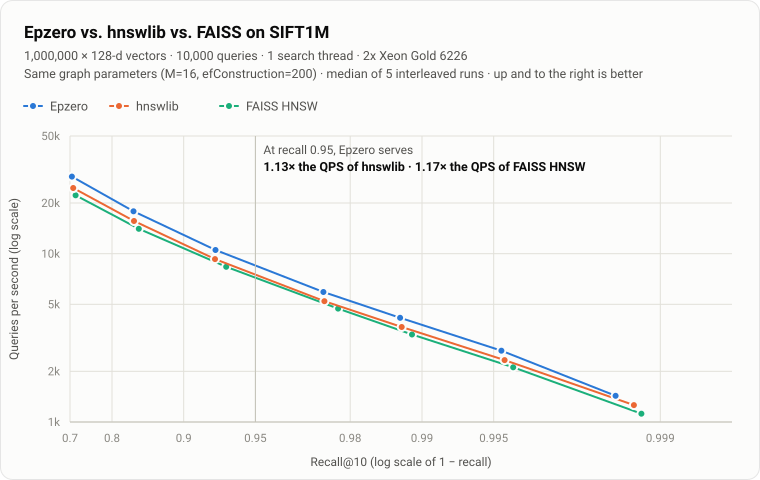
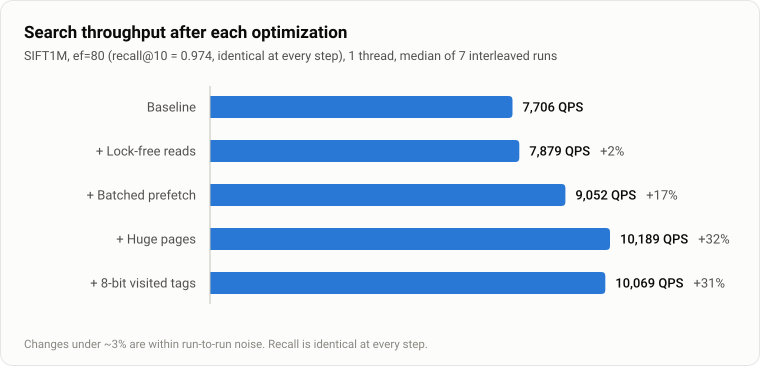

# Oryx

A vector database built from scratch in C++20. It implements HNSW
(Hierarchical Navigable Small World) approximate nearest-neighbor search, with
hand-written SIMD kernels, lock-free concurrent search and memory-system
tuning. On SIFT1M it serves **1.46× the queries per second of hnswlib and 1.40×
FAISS at the same recall**.

The same engine is being built for three targets: native (benchmarks and
servers), WebAssembly (a live, in-browser 3D demo) and a sharded, replicated
cluster.

> **Status:** milestones 1–2 of 9 are done (engine core, benchmarks and
> profiling). See the [roadmap](#roadmap).

<picture>
  <source media="(prefers-color-scheme: dark)" srcset="docs/img/sift1m-recall-qps-dark.svg">
  
</picture>

## Results

**SIFT1M** (1M × 128-dim, 10k queries, official ground truth), 1 search thread,
median of 3 runs. Machine: Intel i5-13420H (AVX2), WSL2 Ubuntu 24.04, GCC 13,
`M=16`, `efConstruction=200`.

| ef  | recall@10 | QPS    | p50 latency | p99 latency | distances/query | vs. brute force |
|-----|-----------|--------|-------------|-------------|-----------------|-----------------|
| 10  | 0.7064    | 47,367 | 20 µs       | 55 µs       | 391             | 1,215×          |
| 40  | 0.9265    | 18,672 | 51 µs       | 113 µs      | 884             | 479×            |
| 80  | 0.9744    | 10,477 | 94 µs       | 208 µs      | 1,484           | 269×            |
| 200 | 0.9955    | 4,718  | 210 µs      | 413 µs      | 3,086           | 121×            |
| 400 | 0.9986    | 2,529  | 396 µs      | 697 µs      | 5,396           | 65×             |

- **Build:** 1M vectors in 42.9 s on 12 threads, vs 55.4 s for hnswlib and 68.4 s
  for FAISS. The index takes 764 MiB. It loads from a snapshot in 0.3 s.
- **Library comparison:** all three libraries were benchmarked in one process
  with interleaved rounds. Methodology and raw data are in
  [docs/performance.md](docs/performance.md).

<picture>
  <source media="(prefers-color-scheme: dark)" srcset="docs/img/optimizations-dark.svg">
  
</picture>

Profiling showed search is memory-latency bound, so the optimizations target
the memory system. The [performance log](docs/performance.md) covers each
change, including the ones that were measured, didn't help and were removed
(graph reordering, early abandoning, LTO/PGO).

**Distance kernels.** Nanoseconds per call, L1-resident data:

| dim | L2 scalar | L2 AVX2 | speedup | IP scalar | IP AVX2 | speedup |
|-----|-----------|---------|---------|-----------|---------|---------|
| 128 | 36.7      | 5.2     | 7.0×    | 35.7      | 4.5     | 8.0×    |
| 384 | 140.6     | 17.5    | 8.1×    | 135.8     | 12.5    | 10.9×   |
| 960 | 412.7     | 48.7    | 8.5×    | 402.8     | 38.6    | 10.4×   |

The speedup is higher than the 8-lane width because the scalar loop is limited
by a serial dependency chain, while the SIMD kernels use two independent FMA
accumulators.

## Engine design

- **Memory layout.** Layer 0 is one contiguous block, aligned to and backed by
  2 MiB transparent huge pages. Each node's vector sits next to its neighbor
  list. Upper layers (about 1/M of the nodes) are stored separately, per node.
- **Search.** Greedy descent through the upper layers, then a beam search of
  width `ef` on layer 0. For each expanded node, unvisited neighbors are
  filtered first and all their vectors prefetched, so up to 32 cache misses
  overlap instead of running one after another.
- **Neighbor selection.** Uses the diversity heuristic from the HNSW paper
  (Algorithm 4), so links point in different directions and the graph stays
  navigable across clusters.
- **Visited set.** An 8-bit epoch-tagged array from a pool. It's 1 MiB for 1M
  nodes, which fits in L2, and it resets without clearing and allocates
  nothing per query.
- **SIMD dispatch.** Each ISA (AVX2, AVX-512, NEON) is compiled in its own
  translation unit and picked at runtime by CPU detection. `ORYX_SIMD=scalar`
  forces a level, e.g. for A/B benchmarks.
- **Concurrency.** Search is lock-free: neighbor-list slots are atomics written
  with release stores and read with acquire loads, so a reader that sees a node
  id also sees that node's vector. Writers are serialized per node, and a
  thread never holds two node locks at once, so lock-order deadlocks are
  impossible. ThreadSanitizer checks this with 8 writers and a concurrent
  reader.
- **Tracing.** Searches can optionally record every hop (layer, from, to,
  distance, accepted). This feeds the 3D visualizer and costs nothing when
  disabled.
- **Persistence.** A versioned binary snapshot format that doesn't depend on
  the in-memory layout. Every link is validated on load, so a corrupt file
  can't cause out-of-bounds reads.

## Python

```bash
pip install ./engine
```

```python
import numpy as np, oryx

index = oryx.Index(dim=128, metric="l2", max_elements=1_000_000, M=16, ef_construction=200)
index.add(vectors, threads=12)                  # labels default to 0..n-1
labels, distances = index.search(queries, k=10, ef=80, threads=1)
trace = index.trace(queries[0], k=10, ef=80)    # every hop, for visualization
index.save("sift.oryx"); index = oryx.Index.load("sift.oryx")
```

Batch calls release the GIL and run on C++ threads.

## Build and test

Linux or WSL2, CMake ≥ 3.20, GCC ≥ 13 or Clang ≥ 17.

```bash
cmake -S engine -B build -G Ninja
cmake --build build
ctest --test-dir build --output-on-failure

build/bench_distance
build/bench_recall --synthetic --n 100000

scripts/download_sift1m.sh
build/bench_recall --base data/sift/sift_base.fvecs --query data/sift/sift_query.fvecs \
                   --gt data/sift/sift_groundtruth.ivecs --queries 10000
python bench/compare_libs.py --data data/sift --cache data/indexes --out bench/results/sift1m-compare.json
```

Sanitizers: `-DORYX_SANITIZE=thread` or `-DORYX_SANITIZE=address,undefined`.
CI runs GCC and Clang on x86-64, GCC on AArch64 (NEON), both sanitizer
configurations, and the Python tests.

## Roadmap

1. ✅ Engine core: HNSW, SIMD kernels, concurrency, snapshots, recall harness, CI
2. ✅ Head-to-head benchmarks against hnswlib and FAISS; profiling-driven optimization; Python bindings
3. WebAssembly build (SIMD128) plus a minimal in-browser search page
4. Offline dataset pipeline: CLIP image embeddings, UMAP layout, int8 export
5. 3D visualizer: layered graph, search replay, recall/QPS explorer
6. In-browser text-to-image search (ONNX Runtime Web)
7. Deletes, write-ahead log, crash recovery; int8 scalar quantization
8. Cluster: Go router, sharded C++ nodes, replication, chaos testing (Oracle Cloud Ampere A1)
9. Filtered search, observability, write-ups
