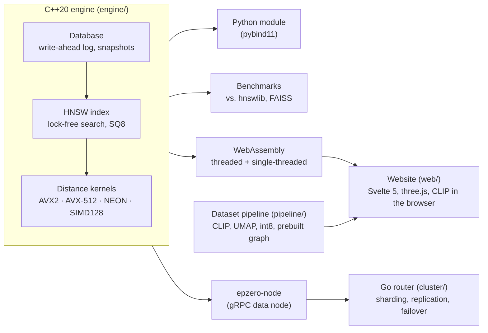

# Epzero

**[epzero.dev](https://epzero.dev/)**

A vector database built from scratch in C++20. It implements HNSW
(Hierarchical Navigable Small World) approximate nearest-neighbor search, with
hand-written SIMD kernels, lock-free concurrent search and memory-system
tuning. On SIFT1M, on a dedicated server where every library gets huge pages,
it serves **1.13× the queries per second of hnswlib and 1.17× FAISS at the same
recall**, builds the graph fastest, and scales to 10× on a 12-core socket.
Against five other libraries on four more datasets (up to 10M vectors and 1,536
dimensions), its 8-bit mode is level with Glass, the fastest, on 960-dimensional
GIST1M, and second to it on OpenAI embeddings
([results](docs/performance.md#against-the-field-four-more-datasets)).

**It also makes recall visible and keeps it on target.** Every approximate
index trades accuracy for speed, and in production nobody measures the
accuracy: it drifts with deletes, filters and new kinds of queries, and a RAG
system then answers from the wrong documents without anyone noticing. Epzero's
recall guard re-answers a small sample of real queries exactly in the
background, reports live recall with a confidence interval, and moves the
search effort to hold a target. Under drift on SIFT1M it held 0.95 recall where
a fixed setting fell to 0.948, at 6–15% less cost than over-provisioning, and its
estimates were within 0.011 of the truth (dedicated server, SIFT1M). It can also say why any given
document wasn't retrieved. [How it works and the evidence →](docs/recall-guard.md)

The same engine runs on three targets: native (benchmarks and servers),
WebAssembly (a live, in-browser demo) and a sharded, replicated cluster (C++
data nodes behind a Go router).

**[Live demo →](https://epzero.dev/)** The engine compiled to
WebAssembly (SIMD128 + threads), running entirely in your browser:
- **[Landing page](https://epzero.dev/).** The engine loads the
  photo index behind the hero and answers live queries, then a
  scroll-driven explainer builds a small HNSW index (the real engine, in
  WebAssembly) and replays a search layer by layer. Click to search it yourself.
- **[Playground](https://epzero.dev/try).** 29,825 Open Images
  photos embedded with CLIP, loaded from a prebuilt graph in ~0.1 s and shown
  as a 3D stack of HNSW layers. The vectors are stored on their principal
  axes, a block of dimensions at a time, so search starts after the first
  2 MB of 16 and **sharpens as the rest streams in**. Search by **description, uploaded photo or webcam**
  (CLIP text and image encoders run in the browser); descriptions are also matched against the
  photos' captions (**hybrid search**: BM25 keywords fused with the vectors, so "tagine" finds the
  photo titled *Tunisian Tagine Malsouka*, which CLIP alone misses). Step through the search
  hop by hop in a debugger, or race it against an exact scan. Every search is
  checked against the exact answer, e.g. *75 µs, 12/12 same results, 45×
  faster*.
  **Blend** a photo with words ("in the snow") and slide between them live;
  **tune and rebuild** the whole index with new `M` / `efConstruction` and
  compare measured recall and speed; orbit, zoom and tap through the 3D
  graph with a navigator HUD following each search. **Filter by category**
  ("dogs only") and see which strategy the engine picked; turn on the **recall
  guard** and watch it hold a recall target live; shift-click (or tap) any star
  to learn **why it is or isn't a result**. **Reset the view** (or `H`) for a
  free look: every panel slides away, leaving just the graph to explore.
- **[Play](https://epzero.dev/play).** *Out-navigate Epzero*: hop
  from photo to photo along the real base-layer links to reach a target,
  then see the route Epzero's search took through its express layers.
- **[Cluster](https://epzero.dev/cluster).** The cluster's Go
  router, compiled to WebAssembly, runs against four simulated nodes. Kill,
  isolate or slow a node and watch the router fail over while searches keep
  their exact answers, then switch between strong and eventual reads and
  check the live history for linearizability with Porcupine.
- **[Benchmarks](https://epzero.dev/benchmarks).** Interactive
  SIFT1M charts against hnswlib and FAISS, the optimization log, SQ8 results,
  and a lab that benchmarks the engine on your own device.

The site works in Chrome, Edge, Firefox and Safari (16.4+), on desktop and
mobile, and offline after one visit. Browsers without WebGL get everything but
the 3D view; browsers too old for WebAssembly SIMD get a clear explanation.

> **Status:** milestones 1–9 are done: milestone 8's cluster is built and tested
> in CI (a real three-node failover on every push), with its cloud deployment on
> hold, and the wider competitive benchmarks (10) are under way. See the
> [roadmap](#roadmap).

<picture>
  <source media="(prefers-color-scheme: dark)" srcset="docs/img/sift1m-recall-qps-dark.svg">
  
</picture>

## Why

Vector search sits under semantic search, recommendations and retrieval for
LLMs, but most people only ever call it through a library. Epzero builds every
layer itself: the graph algorithm, the SIMD distance kernels, lock-free
concurrency, quantization, a crash-safe storage engine, replication with
failover, and a browser build that lets anyone watch a search happen. Each
choice is measured against the best existing libraries, and the ones that
didn't pay off are documented too.

The name is the algorithm's own path. An HNSW search starts at the **e**ntry
**p**oint on a sparse top layer, takes long hops toward the target, and descends
layer by layer to layer **zero**, where the answer is. The site's star-map
visuals and navigator HUD lean on that idea of search as navigation. (The
project was called Oryx until October 2026.)

## Highlights

- **Recall you can see and keep:** live recall estimates with confidence
  intervals from sampled exact checks, a guard that holds a recall target as
  the workload drifts, and an explanation for any miss
  ([details](docs/recall-guard.md)).
- **Filtered search that chooses its own strategy:** an exact scan of the
  allowed vectors, a graph walk that skips excluded ones, or a two-hop walk
  across them, picked per query by a cost model calibrated on a dedicated
  server. Each wins somewhere: from 39k queries/s (0.1% of vectors allowed)
  to 5k (50%), at recall 0.95 on SIFT1M.
- **Per-query search effort:** a search can stop as soon as its own answer
  settles, so easy queries finish early and hard ones search further, and the
  recall guard can steer that instead of one beam width for everything. Under
  drift on GloVe-100, where query difficulty varies widely, it held the same
  target in 13% less time (22% fewer distance computations); on SIFT1M, where it
  varies little, it is about even, so it is opt-in (dedicated server; [details](docs/recall-guard.md#per-query-effort)).
- **Hybrid search:** a BM25 keyword index beside the vector index, merged by
  reciprocal rank fusion, in Python and in the LangChain store, for the exact
  terms (product codes, names, error messages) that embeddings blur.
- **Searches don't stop for writes:** 4,049 writes/s cost concurrent readers
  9% of their throughput, and p99 latency went from 236 to 262 µs.
- **Hardened against malformed files:** libFuzzer runs on every parser of
  untrusted bytes in CI; it found four crash bugs in the index loaders, all
  fixed and kept as regression cases.
- **Faster than the reference libraries** on SIFT1M, at every recall level: 1.13×
  hnswlib's and 1.17× FAISS's queries per second at recall 0.95 on a dedicated
  server, and the fastest 1M-vector build (26.1 s on 24 threads, against 27.8 s
  and 37.8 s). Where huge pages are opt-in, Epzero asks for them and the others
  don't, and the lead grows to 1.46× ([why](docs/performance.md#why-the-laptop-showed-a-bigger-lead-huge-pages)).
- **Near-linear multicore scaling:** lock-free reads reach 10× on the 12 cores of
  one socket, at identical recall, and 109k queries per second on a two-socket
  node with one index copy per socket (+30% over one shared copy).
- **Hand-written SIMD** for AVX2, AVX-512, NEON and WebAssembly SIMD128, picked
  at runtime; up to 10.9× faster than scalar code.
- **8-bit quantization** with exact re-ranking: +48% QPS at identical recall.
  Integer distance kernels (one VNNI instruction per 32–64 dimensions) and
  re-ranking only the best 3 × k made it up to 1.95× faster again on
  960-dimensional GIST1M (laptop; [details](docs/performance.md#what-glass-does-better-and-what-epzero-took-from-it)).
- **Crash safety proven by fault injection:** the write-ahead log survives a
  torn write at every byte offset, mid-log corruption and random `kill -9`s.
- **A replicated cluster** whose failover is tested on every push with real
  processes, a primary killed mid-traffic and zero lost writes, and whose
  `strong` reads are **checked linearizable** under crashes, partitions and
  lossy links by a deterministic simulation and Porcupine. That simulation
  found two replication bugs, both fixed ([details](docs/consistency.md)).
- **The whole engine in the browser:** 29,825 photos searched by text, photo or
  webcam on the visitor's own CPU, with every query checked against an exact
  scan.
- **A production-grade site:** Lighthouse scores 100 for accessibility, best
  practices and SEO on all five pages, with a layout-shift score of 0.02 or
  less; it works offline and is tested in Chromium, Firefox and WebKit on every
  push.

## Architecture



| Directory | Contents |
|---|---|
| [`engine/`](engine) | The C++ library: HNSW, SIMD kernels, quantization, `Database` (WAL), snapshots, tests, benchmarks, Python bindings, the gRPC node server and the WebAssembly bindings |
| [`web/`](web) | The website: Svelte 5 pages, the three.js scene, Web Workers for the engine and the CLIP encoders, the service worker, and Playwright tests |
| [`cluster/`](cluster) | The Go router, its HTTP API and CLI, and the three-node failover test |
| [`proto/`](proto) | The gRPC service between the router and the nodes |
| [`pipeline/`](pipeline) | Builds the demo dataset from Open Images |
| [`bench/`](bench) | Library comparison scripts and the measured results the site's charts use |
| [`deploy/`](deploy) | Terraform, systemd units and a rolling deploy script for the cluster |
| [`docs/`](docs) | The performance log and charts |

**Tech stack.**

| Area | Tools |
|---|---|
| Engine | C++20, CMake, AVX2 / AVX-512 / NEON / WASM SIMD128 intrinsics, pybind11 + scikit-build-core |
| Cluster | Go 1.27, gRPC, Protocol Buffers, Prometheus text metrics |
| Web | Svelte 5, TypeScript, Vite, three.js, Emscripten (pthreads, SIMD), transformers.js on ONNX Runtime Web (CLIP ViT-B/32), service worker |
| Data | PyTorch + CLIP, UMAP, Open Images V7 |
| Testing and CI | CTest, ThreadSanitizer, AddressSanitizer + UBSan, pytest, Go race detector, govulncheck, Playwright (Chromium, Firefox, WebKit), axe-core, GitHub Actions on x86-64 and ARM64 |
| Hosting | Cloudflare Workers (static assets at the edge, the CLIP models in R2 behind a Worker), deployed from CI; Terraform for Oracle Cloud (Ampere A1) |

## Results

**SIFT1M** (1M × 128-dim, 10k queries, official ground truth), `M=16`,
`efConstruction=200`, 1 search thread, median of 3 runs.

**Reference server:** a dedicated node (Slurm `--exclusive`) with 2 × Intel Xeon
Gold 6226 (AVX-512, clock fixed at 2.7 GHz), GCC 13, search pinned to one socket
and its memory. Runs agree within 0.5%. Job scripts: [`scripts/pace/`](scripts/pace/).

| ef  | recall@10 | QPS    | p50 latency | p99 latency | distances/query | vs. brute force |
|-----|-----------|--------|-------------|-------------|-----------------|-----------------|
| 10  | 0.7052    | 28,541 | 34 µs       | 59 µs       | 390             | 1,175×          |
| 40  | 0.9266    | 10,520 | 96 µs       | 132 µs      | 883             | 433×            |
| 80  | 0.9743    | 5,912  | 175 µs      | 220 µs      | 1,484           | 243×            |
| 200 | 0.9954    | 2,651  | 392 µs      | 485 µs      | 3,085           | 109×            |
| 400 | 0.9985    | 1,432  | 727 µs      | 911 µs      | 5,394           | 59×             |

- **Against other libraries:** 1.12–1.14× hnswlib's and 1.16–1.24× FAISS's QPS
  at equal recall, from recall 0.80 to 0.995 (chart below).
- **Against the field:** on GIST1M, GloVe-100, DBpedia OpenAI embeddings and
  DEEP10M, Epzero is ahead of VSAG, FAISS, hnswlib and USearch on every one.
  Glass is the fastest library, but on GIST1M Epzero SQ8 is level with it
  (719 vs 705 QPS at recall 0.95); Glass leads by 1.28× on DBpedia and
  1.7–2.2× on DEEP10M and GloVe
  ([table](docs/performance.md#against-the-field-four-more-datasets)).
- **Build:** 1M vectors in 22.7 s on 24 threads. The index takes 765 MiB.
- **Threads:** 59,636 QPS on 12 threads of one socket (10.0×) and 83,746 on all
  24 (14.0×), at recall 0.974. Crossing sockets costs about 19%; one index copy
  per socket avoids it, reaching 109,186 QPS on the node ([details](docs/performance.md#thread-scaling)).

**Development laptop:** Intel i5-13420H (AVX2), WSL2 Ubuntu 24.04, GCC 13. Its
higher clock (up to ~4.5 GHz) makes single-thread search about 1.8× faster;
per clock cycle the two machines are within about 10%.

| ef  | recall@10 | QPS    | p50 latency | p99 latency | distances/query | vs. brute force |
|-----|-----------|--------|-------------|-------------|-----------------|-----------------|
| 10  | 0.7064    | 47,367 | 20 µs       | 55 µs       | 391             | 1,215×          |
| 40  | 0.9265    | 18,672 | 51 µs       | 113 µs      | 884             | 479×            |
| 80  | 0.9744    | 10,477 | 94 µs       | 208 µs      | 1,484           | 269×            |
| 200 | 0.9955    | 4,718  | 210 µs      | 413 µs      | 3,086           | 121×            |
| 400 | 0.9986    | 2,529  | 396 µs      | 697 µs      | 5,396           | 65×             |

- **Build:** 1M vectors in 42.9 s on 12 threads. It loads from a snapshot in 0.3 s.
- **Library comparison:** all three libraries run in one process with
  interleaved rounds. Methodology, raw data and the huge-pages analysis are in
  [docs/performance.md](docs/performance.md).

<picture>
  <source media="(prefers-color-scheme: dark)" srcset="docs/img/optimizations-dark.svg">
  
</picture>

Profiling showed search is memory-latency bound, so the optimizations target
the memory system. The [performance log](docs/performance.md) covers each
change, including the ones that were measured, didn't help and were removed
(graph reordering, early abandoning, LTO/PGO, and RaBitQ in memory). The
story, for a general audience: [Vector search is a memory problem](docs/blog/vector-search-is-a-memory-problem.md).

**Distance kernels.** Nanoseconds per call, L1-resident data:

| dim | L2 scalar | L2 AVX2 | speedup | IP scalar | IP AVX2 | speedup |
|-----|-----------|---------|---------|-----------|---------|---------|
| 128 | 36.7      | 5.2     | 7.0×    | 35.7      | 4.5     | 8.0×    |
| 384 | 140.6     | 17.5    | 8.1×    | 135.8     | 12.5    | 10.9×   |
| 960 | 412.7     | 48.7    | 8.5×    | 402.8     | 38.6    | 10.4×   |

The speedup is higher than the 8-lane width because the scalar loop is limited
by a serial dependency chain, while the SIMD kernels use two independent FMA
accumulators.

## Engine design

- **Memory layout.** Layer 0 is one contiguous block, aligned to and backed by
  2 MiB transparent huge pages. Each node's vector sits next to its neighbor
  list. Upper layers (about 1/M of the nodes) are stored separately, per node.
- **Search.** Greedy descent through the upper layers, then a beam search of
  width `ef` on layer 0. For each expanded node, unvisited neighbors are
  filtered first and all their vectors prefetched, so up to 32 cache misses
  overlap instead of running one after another.
- **Neighbor selection.** Uses the diversity heuristic from the HNSW paper
  (Algorithm 4), so links point in different directions and the graph stays
  navigable across clusters.
- **Visited set.** An 8-bit epoch-tagged array from a pool. It's 1 MiB for 1M
  nodes, which fits in L2, and it resets without clearing and allocates
  nothing per query.
- **SIMD dispatch.** Each ISA (AVX2, AVX-512, NEON) is compiled in its own
  translation unit and picked at runtime by CPU detection. `EPZERO_SIMD=scalar`
  forces a level, e.g. for A/B benchmarks.
- **Concurrency.** Search is lock-free: neighbor-list slots are atomics written
  with release stores and read with acquire loads, so a reader that sees a node
  id also sees that node's vector. Writers are serialized per node, and a
  thread never holds two node locks at once, so lock-order deadlocks are
  impossible. ThreadSanitizer checks this with 8 writers and a concurrent
  reader.
- **Tracing.** Searches can optionally record every hop (layer, from, to,
  distance, accepted). This feeds the 3D visualizer and costs nothing when
  disabled.
- **8-bit scalar quantization (SQ8).** Nodes are stored as uint8 codes with
  per-dimension scales, scored against the float query by asymmetric distance
  (a single uint8×float dot product), then re-ranked exactly. On SIFT1M this
  gives **+48% QPS at identical recall**, or 58% less memory without the float
  vectors. See the [performance log](docs/performance.md#8-bit-scalar-quantization-sq8).
- **Deletes.** Tombstones that keep routing searches but are never returned or
  linked to again; `compacted()` rebuilds the index without them. Five cycles
  of deleting and re-inserting 10% of SIFT1M cost 0.5 points of recall and 26%
  of throughput; a 35 s compaction restores both.
- **Durability.** `Database` adds a write-ahead log: CRC32C-framed records,
  fsync per write or group commit, and atomic checkpoints (the snapshot is
  written, fsynced and renamed before `CHECKPOINT` switches to it). Recovery
  replays newer records and truncates a torn tail. Tests cut the last record
  at every byte offset, corrupt records in the middle of the log, and
  `kill -9` a writer process at random moments; every acknowledged write
  survives.
- **Persistence.** A versioned binary snapshot format that doesn't depend on
  the in-memory layout. Every link is validated on load (it must name a node
  that exists on that link's layer), headers are checked against the file size
  before anything is allocated, and loading can be capped by memory. Fuzzing in
  CI keeps it that way.
- **Filtered search.** A filter is compiled once against the index (a bitset
  plus the allowed slots) and reused by every query. Each query then picks a
  strategy from the filter's selectivity and the beam width: score the allowed
  vectors directly when few pass, walk the graph keeping only allowed results
  when a quarter or more pass, and in between walk only allowed nodes,
  stepping past an excluded neighbour to its own neighbours (the idea behind
  ACORN) so the walk stays connected. Below 1.5% that walk can't reach the
  target recall, so Auto weighs a scan against the plain walk by estimated
  cost. The thresholds come from measuring every strategy at 12 selectivities
  on a dedicated server (`bench/results/pace/gold6226/sift1m-filter.json`).
  Re-measured there against the earlier fixed thresholds: filters allowing
  0.5–1% of the vectors went from recall as low as 0.34 to 1.000 at every
  beam width, 30% filters got 24–36% faster, and exact scans no longer slow
  down as the beam widens (38.6k queries/s at 0.1%, was 11k at `ef` 320).
- **Recall monitoring and control.** See [docs/recall-guard.md](docs/recall-guard.md).

## Python

```bash
pip install epzero                 # wheels for Linux and macOS, Python 3.10-3.13
pip install "epzero[langchain]"    # plus the LangChain vector store
pip install ./engine               # or build from this repository
```

```python
import numpy as np, epzero as epzero

index = epzero.Index(dim=128, metric="l2", max_elements=1_000_000, M=16, ef_construction=200)
index.add(vectors, threads=12)                  # labels default to 0..n-1
labels, distances = index.search(queries, k=10, ef=80, threads=1)
trace = index.trace(queries[0], k=10, ef=80)    # every hop, for visualization
index.save("sift.epzero"); index = epzero.Index.load("sift.epzero")

# 8-bit quantization: train on a sample, then add as usual
sq8 = epzero.Index(dim=128, quantization="sq8")
sq8.train(vectors[:100_000]); sq8.add(vectors, threads=12)

# Filtered search: a compiled filter is reused across queries
dogs = index.filter(dog_labels)                  # epzero.Filter: dogs.allowed, dogs.selectivity
labels, _ = index.search(queries, k=10, ef=80, filter=dogs)

# Recall you can see and keep
guard = epzero.RecallGuard(index, target=0.95, sample_rate=0.01, reference_ef=1024)
labels, _ = guard.search(queries, k=10)
print(guard.report())                           # per segment: ef, recall estimate, 95% interval
print(index.explain(queries[0], k=10, label=4217, ef=80))   # why it was or wasn't returned

# Durable collection with a write-ahead log and crash recovery
db = epzero.Database.open("./vectors.db", dim=128, sync="always")
db.upsert(vectors[:1000], labels=ids)           # one log write + fsync per batch
db.remove(42)
print(db.recovery())                            # what the last open() replayed or truncated
```

Batch calls release the GIL and run on C++ threads.

**LangChain.** `epzero.langchain.EpzeroVectorStore` is a LangChain vector store: add texts or
documents, search by similarity (with scores) or maximal marginal relevance, filter on metadata
(compiled into an Epzero filter, so the engine picks its filtered-search strategy), delete and
replace by id, and save and load a folder. It passes LangChain's standard vector-store
conformance suite (`langchain-tests`) in CI, sync and async; that suite also found a real engine
bug (new vectors were unreachable after every existing one had been deleted), now fixed.

```python
from epzero.langchain import EpzeroVectorStore

store = EpzeroVectorStore.from_texts(texts, embeddings, metadatas=metadatas)
docs = store.similarity_search("reset my password", k=4, filter={"source": "faq"})
retriever = store.as_retriever(search_kwargs={"k": 8})
```

## WebAssembly

The same C++ core compiles to WebAssembly with a SIMD128 kernel as one more
dispatch level. Two modules are shipped:
- a **threaded** build, which runs builds and exact search on every core via
  Web Workers sharing memory;
- a **single-threaded** fallback, for pages that aren't cross-origin isolated.

In production Cloudflare sends the isolation and security headers
([`web/public/_headers`](web/public/_headers)); on a host that can't, a service
worker adds them (recovering by itself after a hard refresh, which bypasses it).
The same worker caches the site for offline use. The page also sets a Content Security Policy: only the
site's own code runs, with no `eval` (the bindings are built with
`-sDYNAMIC_EXECUTION=0`) and one inline script, the theme bootstrap, allowed by
a hash computed at build time. The whole C++ test suite also runs as
WebAssembly under Node in CI.

```bash
source emsdk/emsdk_env.sh
scripts/build_wasm.sh                 # -> web/public/wasm/{mt,st}
cd web && npm install && npm run dev  # http://localhost:5173/
npx playwright test                   # every end-to-end suite (see below)
```

The end-to-end suites run on every push: all five pages in Chromium (desktop
and touch phone, both themes), the core journeys in Firefox and WebKit, an
automated WCAG 2.1 AA audit (axe-core), the webcam path and every camera error,
offline use, a browser without WebGL, one without WebAssembly SIMD, and a
server that sends no isolation headers (the service worker's fallback). Deploying
to Cloudflare is described in [`web/DEPLOY.md`](web/DEPLOY.md).

The engine and both CLIP encoders run in Web Workers, so the page never blocks
on a search, an encode or an index rebuild. Other details of the site:
- **Fast first load.** Data files download in parallel and are read straight
  from the cache on repeat visits; the models load only once the index is
  ready, and are warmed in the background only on capable devices.
- **No layout shift.** Web fonts fall back to size-matched local fonts, and
  every live element (loading status, results sheet, debugger) reserves its
  space.
- **Machines without a GPU.** When WebGL runs on the CPU, the 3D scene detects
  it and switches to a calm mode that draws only when something changes, so
  the page stays responsive. Frame cost is measured everywhere, and quality
  steps down on slow GPUs.
- **Accessible.** WCAG 2.1 AA colour contrast in both themes, keyboard
  shortcuts (`?` lists them), reduced-motion support and screen-reader labels.

## Demo dataset

[`pipeline/build_dataset.py`](pipeline/build_dataset.py) builds the
explorer's data. It takes the Open Images V7 validation photos that are still
online (29,825 of 35,479), embeds them with CLIP ViT-B/32 on the GPU (92 s on
an RTX 4050), lays them out in 2-D with UMAP, and exports compact binaries:
- **int8 vectors** with per-dimension scales: 15 MB instead of 61 MB, with
  recall@10 of 0.994 against float vectors;
- a 16-bit layout;
- metadata with each photo's author, license and source link;
- a **prebuilt HNSW graph** (links only, 1.3 MB), so browsers load the index
  in ~0.1 s instead of building it; `web/scripts/build-graph.sh` regenerates it.

Photos are CC BY 2.0 and hotlinked from Flickr with attribution, and labels
are CC BY 4.0. (Unsplash Lite was evaluated and rejected: its terms forbid
publishing any portion of the data.)

```bash
pip install torch transformers umap-learn pillow
python pipeline/build_dataset.py --work data/openimages --out web/public/data/openimages
```

## Cluster

`cluster/` holds the distributed version: C++ data nodes (`epzero-node`, gRPC,
each with its own write-ahead log) and a Go router in front of them.

- **Sharding and replication.** Each shard has a primary and a backup on
  different nodes. Writes go to the primary, which forwards them synchronously
  to an in-sync backup before acknowledging (the reply says if it couldn't:
  `replicated: false`); epochs act as fencing tokens so a demoted primary
  can't accept writes.
- **Many routers, one leader.** With `-etcd`, routers share the shard map through etcd: all
  of them serve traffic, and an elected leader fails shards over, with every map change a
  compare-and-swap fenced by its election key. Without etcd a single router keeps the map in
  a local file.
- **Read consistency.** `strong` reads only primaries and is linearizable;
  `eventual` also reads in-sync backups, hedged, for lower tail latency.
  [What each guarantees, and how it is tested →](docs/consistency.md)
- **Failover and recovery.** The router health-checks every node, promotes the
  backup when a primary stops answering, and catches a returning node up from
  its peer (log records, or a snapshot when it's too far behind).
- **Queries.** Fanned out to every shard with hedged requests (the other copy
  is asked if the first is slow), then the top-k is merged.
- **API.** `POST /v1/search` is open; `upsert`, `remove` and the chaos
  `crash` endpoint need a bearer token, compared in constant time. Request
  bodies are size-limited, vectors are validated, and the server has read,
  write and idle timeouts. `GET /metrics` serves Prometheus metrics.

```bash
cmake --build build --target epzero_node
cd cluster && EPZERO_NODE_BIN=../build/epzero-node go test -race -tags integration ./...
```

CI runs that test on every push: three real nodes, a primary killed mid-traffic,
failover, recovery, and a check that no acknowledged write was lost. It also runs
`cluster/sim`: the same router against simulated nodes on a virtual clock
(`testing/synctest`), with crashes, partitions and lossy links, and checks the
read/write history with [Porcupine](https://github.com/anishathalye/porcupine).
The site's cluster page is that simulation, compiled to WebAssembly
(`scripts/build_sim_wasm.sh`). It also
checks formatting and scans for known vulnerabilities reachable from the code.
`deploy/` has the Terraform (Oracle Cloud Always Free, Ampere A1), systemd
units and a rolling-restart deploy script; credentials stay outside the
repository.

## Build and test

Linux or WSL2, CMake ≥ 3.20, GCC ≥ 13 or Clang ≥ 17; Go ≥ 1.27 for the
cluster; Node ≥ 22 for the site.

```bash
cmake -S engine -B build -G Ninja
cmake --build build
ctest --test-dir build --output-on-failure

build/bench_distance
build/bench_recall --synthetic --n 100000

scripts/download_sift1m.sh
build/bench_recall --base data/sift/sift_base.fvecs --query data/sift/sift_query.fvecs \
                   --gt data/sift/sift_groundtruth.ivecs --queries 10000
python bench/compare_libs.py --data data/sift --cache data/indexes --out bench/results/sift1m-compare.json
```

Sanitizers: `-DEPZERO_SANITIZE=thread` or `-DEPZERO_SANITIZE=address,undefined`.
Fuzzing (Clang): `-DEPZERO_BUILD_FUZZ=ON` builds libFuzzer targets for snapshot
loading, graph import and write-ahead-log recovery. CI runs GCC and Clang on
x86-64, GCC on AArch64 (NEON), both sanitizer configurations, a minute of
fuzzing per target plus every past finding, the Python tests, and the test
suite as WebAssembly under Node.

More benchmarks: `bench_filter` (every filtered-search strategy across
selectivities), `bench_churn` (search latency under concurrent writes; recall
through delete/re-insert cycles) and `bench_guard` (recall under drift). The
dedicated-server runs are in [`scripts/pace/`](scripts/pace/).

## Roadmap

1. ✅ Engine core: HNSW, SIMD kernels, concurrency, snapshots, recall harness, CI
2. ✅ Head-to-head benchmarks against hnswlib and FAISS; profiling-driven optimization; Python bindings
3. ✅ WebAssembly build (SIMD128 + threads) and an in-browser benchmark lab, live at epzero.dev
4. ✅ Offline dataset pipeline: CLIP image embeddings, UMAP layout, int8 export
5. ✅ 3D explorer: layered graph, animated search replay, exact-scan comparison
6. ✅ In-browser text-to-image search (CLIP text encoder on ONNX Runtime Web, self-hosted)
7. ✅ Deletes, write-ahead log, crash recovery; 8-bit scalar quantization
8. ✅ Cluster: Go router, sharded C++ nodes, replication, failover testing in CI (cloud deployment on hold); deterministic fault simulation with linearizability checking, and the router in the browser
9. ✅ Filtered search; recall monitoring, the recall guard and the miss explainer; fuzzing
10. ✅ `pip install epzero` (wheels for Linux and macOS) and a LangChain vector store that passes LangChain's conformance suite
11. ✅ Several routers sharing the shard map through etcd, with leader election and fenced writes
12. ✅ RaBitQ quantization (correct and tested; not faster in memory, see the performance log)
13. ✅ Competitive benchmarks on GIST1M, GloVe-100, OpenAI text embeddings and DEEP10M against Glass, VSAG, USearch, hnswlib and tuned FAISS (`bench/compete.py`)
14. ✅ Per-query search effort and the per-query recall guard; integer SQ8 kernels; hybrid keyword + vector search
15. ✅ Per-query guard and one index copy per socket measured on the server
16. ✅ The comparison re-run with the integer SQ8 kernel: level with Glass on GIST1M, +34% on DBpedia
17. DEEP10M and GloVe re-measured with the outlier split gated per query; an ann-benchmarks submission (`ann-benchmarks/`)

## License

The code is under the [MIT License](LICENSE). The demo's photos are not: each keeps its own
license from its author (credited, with a link to the source, wherever a photo is shown).
