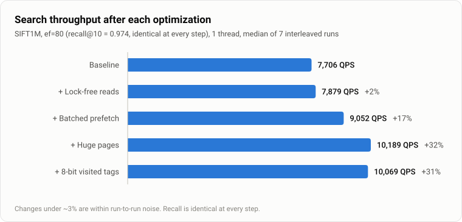
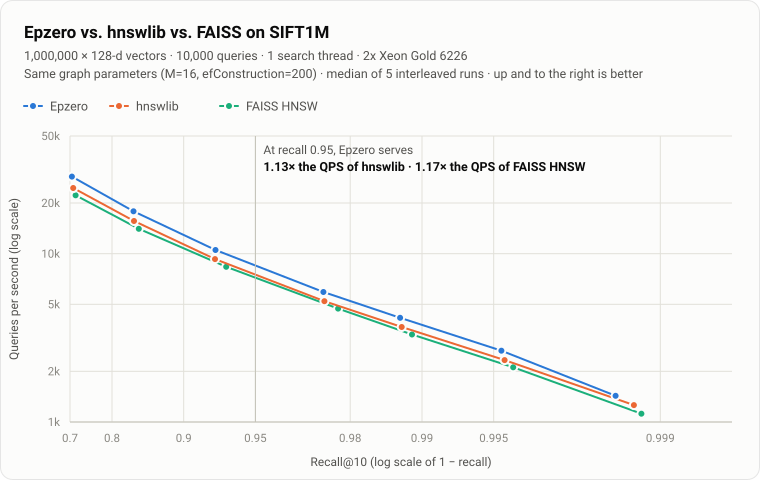

# Performance engineering log

How Epzero's search got 31% faster, and which ideas didn't work. Each change was
kept only if an interleaved A/B test on SIFT1M showed a gain.

<picture>
  <source media="(prefers-color-scheme: dark)" srcset="img/optimizations-dark.svg">
  
</picture>

## Methodology

- **Workload:** SIFT1M (1M × 128-dim base vectors, 10k queries, official exact
  ground truth). Graph built with M=16, efConstruction=200. Queries run on 1
  thread with k=10.
- **Same graph for every search change.** The index is built once, saved and
  reloaded by every candidate binary, so search changes are measured on an
  identical graph and recall is identical by construction (verified: 0.9744 at
  every step).
- **Interleaved A/B.** Candidate binaries run in alternating order for 5–7
  rounds, and the median is reported. The machine is a laptop CPU under WSL2
  (Intel i5-13420H, which has both P-cores and E-cores). Hyper-V hides which
  core a thread runs on, so pinning isn't possible. Interleaving makes frequency
  drift and scheduler noise affect every candidate equally. Differences under
  ~3% are treated as noise.
- **Library comparison.** Epzero, hnswlib and FAISS (`IndexHNSWFlat`) are loaded
  into one process and queried in interleaved rounds, each through its own C++
  batch loop, so Python call overhead isn't part of the timing.
  See [`bench/compare_libs.py`](../bench/compare_libs.py).
- **Server runs.** The library comparison and the scaling numbers come from a dedicated node on
  Georgia Tech's PACE cluster: 2 × Xeon Gold 6226, AVX-512, clock fixed at 2.7 GHz, no other jobs
  on the node (Slurm `--exclusive`), search pinned with `numactl` to one socket and its memory.
  Runs agree within 0.5%, against a few percent on the laptop. The job scripts are in
  [`scripts/pace/`](../scripts/pace/).

## Where the time goes

`perf record` on the search phase (hardware counters aren't available under
WSL2, so this is timer-based sampling):

| Hotspot | Share of search samples | Interpretation |
|---|---|---|
| `l2_avx2` | ~57% | Mostly stalls: each 128-dim vector is 512 bytes (8 cache lines) at a random address |
| `search_layer` | ~30% | Heap operations, visited-set checks, loop control |
| `pthread_mutex_lock/unlock` | ~12% | Readers locking each node's neighbor list |

At about 63 ns per distance evaluation, search is **bound by memory latency**,
not by computation. That points to changes that improve memory access, not
instruction-level changes.

## Kept

| Change | Result | Why it works |
|---|---|---|
| **Batched prefetch.** Filter a node's unvisited neighbors first, prefetch all their vectors, then score them | **+15%** | Up to 32 cache misses are in flight at once instead of one per distance call. On the laptop, prefetching only the first line was enough (64, 128, 256 and 512 bytes all measured the same; no prefetch at all was 14% slower). This does not hold across CPUs: see the prefetch section below |
| **2 MiB transparent huge pages** for the layer-0 block (`madvise(MADV_HUGEPAGE)`, 2 MiB aligned) | **+13%**, p99 −16% | 764 MB spans ~190k 4 KiB pages, far more than the TLB covers, so almost every node visit was also a page walk. With huge pages it's ~380 pages. Verified via `AnonHugePages` in `/proc/<pid>/smaps_rollup` (672 MB huge-page backed) |
| **Lock-free reads.** Neighbor-list slots are written with release stores and read with acquire loads (compiler atomic builtins) | +2% (noise) | No throughput gain: uncontended mutexes are cheap, and the profiler overstated them. Kept because a search now never waits behind an insert, and the memory-ordering argument is simple (see [`hnsw.h`](../engine/include/epzero/hnsw.h)). Checked with ThreadSanitizer under concurrent inserts and searches |
| **8-bit visited tags** (1 MiB for 1M nodes vs 2 MiB) | −1% to +3% (noise) | Fits the P-core's 1.25 MiB L2 and halves per-search scratch memory. The extra full clear every 255 queries costs ~0.1 µs per query. Since replaced by one bit per node (below) |
| **One sorted beam instead of two heaps.** The best `ef` nodes in one sorted array, each marked once expanded; a cursor points at the closest unexpanded one | **+9–19% SQ8, +3–10% float** (SIFT1M, GloVe-100, GIST1M) | With 8-bit codes, a 100-dim distance is a few instructions and the bookkeeping around it dominates: `perf` put a heap's `pop` alone at 13% of GloVe-100 search time, and the search loop (heap pushes, visited checks) at 56%. An insert into the sorted array is a binary search and a short `memmove` in L1; taking the next node is a cursor step. It also says where a node landed, so patience ("did the best k change?") costs nothing. Indexes with deletions keep the heap version, which counts only live nodes |
| **One visited bit per node** (128 KiB for 1M nodes), cleared through the list of nodes the search marked | +1–25% at 1M (most on GIST1M; noise on SIFT1M); **+16–28% at 5M** | The 8-bit tags were 1.2 MiB on GloVe-100 and 10 MiB on DEEP10M: past a server core's 1 MiB L2, every "seen it?" check could miss, and a missing check holds up the prefetches queued behind it. `perf` showed ~8% of GloVe search time stalled on that load. A search marks a few thousand nodes, so clearing them one by one is cheaper than an epoch. On a 5M × 96 SQ8 index (5 MiB of tags against 625 KiB of bits) it gave +16–28%, and with the sorted beam and the descent prefetch +23–37%, at identical recall. It was the likeliest explanation for Epzero losing more speed on the server than Glass did (116 ns per distance there against 34 ns on the laptop; Glass 51 and 38 ns), but the server re-run says otherwise: with the bitset and the sorted beam, uncompressed Epzero on GloVe-100 stayed at 1,294 queries a second (1,301 before), so that gap has another cause |
| **Prefetch in the upper-layer descent** | +1–11% (largest at small `ef`) | Upper-layer nodes are scattered, and the descent scored them one cache miss at a time. They are now requested together before scoring, as on layer 0 |

## Tried and removed

| Idea | Result | Why it didn't help |
|---|---|---|
| **BFS graph reordering** (renumber nodes so graph neighbors are adjacent in memory) | 0% | Node records are 704 bytes, so neighbors never share cache lines; huge pages had already solved the TLB problem; and a query's ~1,500 nodes don't fit in L3 in any order |
| **Exact early abandoning** (stop an L2 computation once the partial sum exceeds the current k-th best) | −10% (checks every 32 dims), 0% (every 64) | Lossless, but the horizontal sum at each checkpoint breaks the FMA pipeline, and the prefetcher has already pulled the lines the early exit would skip. Probably worthwhile only with a variance-concentrating rotation on high-dimensional data (ADSampling-style); revisit with 512–1536-dim embeddings |
| **Several queries walked side by side on one thread** (`search_batch`: 4 or 8 queries in flight, each step of one query overlapping the others' cache misses, sharing one visited byte per node with a bit each) | 0% to −10% (SIFT1M, GIST1M, DBpedia), −15% to −39% (GloVe-100); identical results | The premise was that a search waits on a chain of dependent cache misses. It mostly doesn't: prefetching a node's whole neighbour list already keeps the CPU's miss buffers full, so there was little idle time to fill, and eight queries' working sets pushed each other out of cache. `perf` then showed where the time really went (heap operations, visited checks), which led to the two changes above |
| **Neighbour codes** (each node stores a 1-bit RaBitQ code of every neighbour, relative to the node itself, in one block; expanding a node estimates all its neighbours from that block and skips those whose lower bound can't enter the beam) | GIST1M: skips 60% of distance computations at identical recall (74% with no error margin, recall −0.0005), yet 0.9–1.06× the throughput. GloVe-100: skips 40%, 0.7×. Steering the walk by the estimates instead (exact distances only for expanded nodes) cut random reads 7–11×, but needed about twice the `ef` for the same recall: 1.15–1.25× on GIST1M, slower on GloVe | With 8-bit codes and VNNI, an exact 960-dimension distance is ~30 instructions, while a 1-bit estimate with a 4-bit query is 64 popcounts plus a per-expansion pass over the query's residual: the estimate costs about what it saves, and prefetching already hides most of the memory it avoids. The block adds ~1 KiB per node at 100 dimensions and ~5 KiB at 960. A FastScan layout (32 neighbours per shuffle) might make it ~1.5× on 960–1,536-dimension data, never on 96–128 |
| **LTO and PGO** | ±2% (noise) | The code is memory-bound; better branch layout doesn't shorten DRAM latency |
| **Chunked snapshot I/O** (8 MiB `fread` + `memcpy` instead of `istream`) | 0.31 s → 0.31 s to load 1M vectors | Loading was dominated by allocating and zeroing 764 MB and rebuilding the label map, not by parsing. Kept for its explicit error handling, without claiming a speedup |

## Result against other libraries

<picture>
  <source media="(prefers-color-scheme: dark)" srcset="img/sift1m-recall-qps-dark.svg">
  
</picture>

The reference run is on a dedicated server node: 2 × Intel Xeon Gold 6226 (Cascade Lake, 24
cores, AVX-512, clock fixed at 2.7 GHz), Slurm `--exclusive`, search pinned to one socket and its
local memory. Repeated runs agree within 0.5%. At the same recall (0.95), Epzero serves **1.08×
hnswlib's QPS and 1.12× FAISS's**, and the lead holds at every recall level (1.06–1.08× and
1.12–1.18× between recall 0.80 and 0.995). It also builds the graph fastest: 24.0 s, against 27.8 s
and 37.8 s, on 24 threads. (An earlier engine measured 1.13× and 1.17× here: today's is about 4%
slower on full-precision SIFT1M on this server while hnswlib held steady, and
[`scripts/pace/ab.sbatch`](../scripts/pace/ab.sbatch) bisects which change did it.) Raw data:
[`bench/results/pace/gold6226/sift1m-compare.json`](../bench/results/pace/gold6226/sift1m-compare.json).

All three libraries implement the same algorithm, and graph quality is essentially identical
(recall matches at each `ef`). The difference is memory-system engineering: batched prefetching,
the node layout and the visited set.

### Why the laptop showed a bigger lead (huge pages)

The first comparison, on the development laptop, measured **1.46× hnswlib and 1.40× FAISS**.
The server's smaller lead is explained by transparent huge pages:

| Setup (SIFT1M, equal recall, one search thread) | vs hnswlib | vs FAISS |
|---|---|---|
| Laptop: huge pages opt-in (`madvise`); only Epzero asks for them | 1.44–1.55× | 1.39–1.55× |
| Laptop: no library on huge pages (`EPZERO_NO_HUGEPAGES=1`) | 1.18–1.25× | 1.21–1.35× |
| Server: huge pages for every program (`always`) | 1.06–1.08× | 1.12–1.18× |

A random walk over a 765 MB graph misses the TLB on almost every node with 4 KiB pages. Epzero
requests 2 MiB pages for its graph (`MADV_HUGEPAGE`), which is worth about 16% on its own: turning
the request off cut its QPS at recall 0.97 from 11,556 to 9,999, and the kernel reported no huge
pages in use. hnswlib and FAISS don't ask, so they get huge pages only where the kernel hands them
to every program. Asking for them is still a real advantage on kernels where they are opt-in; but
the like-for-like comparison is on equal pages, and there Epzero's design is worth about 1.13–1.25×
depending on the CPU. Laptop data:
[`bench/results/sift1m-compare.json`](../bench/results/sift1m-compare.json).

### Against the field: four more datasets

SIFT1M is one dataset with 128 dimensions. [`bench/compete.py`](../bench/compete.py) runs Epzero and
five other libraries (eight configurations in all) on four more ann-benchmarks datasets on the same server node. The rules match the SIFT1M
comparison: the same graph degree (M = 16, i.e. 32 links on the base layer) and build beam (200),
every index built on all 24 cores and then searched from one process on one thread pinned to one
socket, the median of three interleaved rounds. Each library's QPS is interpolated (log-linear)
to the same recall@10.

| Library | GIST1M, 960-D (recall 0.95) | GloVe-100 (recall 0.90) | DBpedia OpenAI, 1,536-D (recall 0.95) | DEEP10M, 10M × 96-D (recall 0.95) |
|---|---|---|---|---|
| Epzero | 352 | 1,301 | 1,444 | 3,884 |
| Epzero SQ8 | **768** | 2,435 | 3,137 | **7,409** |
| hnswlib | 356 | 1,133 | 1,448 | 3,615 |
| FAISS HNSW | 336 | 1,154 | 1,629 | 3,362 |
| FAISS IVF-PQ | never reaches | never reaches | 1,545 | never reaches |
| USearch | 261 | 735 | 1,072 | 2,056 |
| VSAG | 411 | 1,049 | 1,871 | 3,136 |
| Glass | 708 | **2,865** | **4,094** | 6,443 |

- **Epzero SQ8 is the fastest of the eight on GIST1M and DEEP10M**: 1.08× Glass on GIST1M and
  1.15× on DEEP10M at recall 0.95. On DEEP10M that took two fixes: applying the exact outlier
  weights only to the queries that need them (+25%), then not scoring 8-bit codes with the AVX-512
  kernel on this Cascade Lake Xeon, where it was far slower on short vectors (below; +66%).
- **Glass leads on GloVe-100 (1.18×) and DBpedia (1.31×).** Like Epzero SQ8 and VSAG it walks the
  graph on 8-bit codes and re-ranks with the full vectors, and it measures the best prefetch
  distance for the machine before searching (its `optimize` step). Its own results vary by about
  10% between runs (GIST1M: 705 to 795 queries a second), as it rebuilds its graph each time.
- **Uncompressed, Epzero is level with hnswlib** on the high-dimensional sets (GIST 352 vs 356,
  DBpedia 1,444 vs 1,448) and ahead on the low-dimensional ones (DEEP10M +7%, GloVe +15%). With
  960 or 1,536 dimensions, each distance is a long, bandwidth-bound scan, and the memory work
  around it (prefetching, the visited set) is a small share of the time. On DBpedia, FAISS HNSW
  (+13%) and VSAG are ahead of uncompressed Epzero.
- **GloVe is compared at recall 0.90**: at M = 16 no library but VSAG reaches 0.95 by `ef` = 800
  (the others top out at 0.942–0.946). Tuned FAISS IVF-PQ reaches 0.95 only on DBpedia.
- **Build is not Epzero's strength here.** On SIFT1M it built fastest; on these sets hnswlib builds
  5–30% faster (GIST 167 s vs 213 s, DBpedia 220 s vs 288 s, DEEP10M 315 s vs 335 s).

| Build, 24 threads | GIST1M | GloVe-100 | DBpedia OpenAI | DEEP10M |
|---|---|---|---|---|
| Epzero | 213 s | 42 s | 288 s | 335 s |
| hnswlib | 167 s | 45 s | 220 s | 315 s |
| FAISS HNSW | 219 s | 45 s | 335 s | 384 s |
| USearch | 178 s | 51 s | 220 s | 422 s |
| VSAG | 159 s | 73 s | 251 s | 468 s |
| Glass | 223 s | 38 s | 299 s | 462 s |

Caveats: VSAG is searched one query per Python call (about 1–2 µs of overhead each, small next to
its 250 µs–3 ms queries). Glass's saved graph lost recall when loaded back, so it is rebuilt for
the search run; its build time is from the build run. The DBpedia dataset is generated the way
ann-benchmarks does it ([`scripts/make_dbpedia.py`](../scripts/make_dbpedia.py)): 990,000 base
vectors, 10,000 queries, exact neighbours. Raw data: `bench/results/pace/gold6226/*-compete.json`.

### What Glass does better, and what Epzero took from it

The guess was memory-system tricks (tuned prefetching, a batched query loop). Reading Glass's
search code ([zilliztech/pyglass](https://github.com/zilliztech/pyglass), `graph_searcher.hpp`,
`refiner.hpp`, `sq8u_quant.hpp`) showed something else. Its single-thread batch search is a plain
loop over queries, so batching isn't it. Three differences are:

1. **It re-ranks 15 candidates, not the whole beam.** Glass walks the graph on 8-bit codes and then
   re-scores the best 1.5 × k with full vectors. Epzero re-scored every one of its `ef` candidates: at
   `ef` 400 on GIST that is 400 extra reads of a 3.8 KB vector per query. Re-ranking 15, 20, 30, 50
   or 100 gave the same recall as re-ranking all of them (to 0.0002, on SIFT1M, GloVe-100 and
   GIST1M), so the default became 3 × k, and later 2 × k: against 3 × k, the same recall (to 0.0003,
   also on OpenAI embeddings) and 3-13% more queries per second where full vectors are large
   (GIST1M +3-10%, DBpedia +7-13%; laptop).
2. **Its distances are integer arithmetic.** Glass quantizes the query too, with one scale for all
   dimensions, and scores int8 against int8. Epzero kept its per-dimension scales (more accurate
   codes) and changed only the arithmetic: the per-query weights, already folded with the scales,
   are rounded to int8 once per query, and each node is then an integer dot product of those
   weights with its uint8 codes. On CPUs with VNNI that is one `vpdpbusd` per 64 dimensions (AVX-512)
   or 32 (AVX), against about ten instructions per 32 dimensions for the float kernel; plain AVX2
   gets a `maddubs` kernel. Weights stay within ±63 so the AVX2 kernel's 16-bit pair sums can't
   saturate, and every kernel returns exactly the same integer. Recall changed by at most 0.001.
3. **It tunes its prefetching to the machine** (how many neighbours ahead, how many cache lines),
   by timing searches of sample points. Epzero's default, every neighbour's first line up front, is
   already close to Glass's best settings on most data; `HnswIndex::tune_prefetch()` now measures a
   small grid of alternatives on sample vectors and keeps one only if it is at least 3% faster.

Measured on the development laptop (Intel i5-13420H, AVX2 with AVX-VNNI; WSL2), one search thread,
the same saved index for every variant, interleaved runs, median of three:

| SQ8, queries per second | GIST1M, ef 400 (recall 0.953) | GloVe-100, ef 256 (0.883) | SIFT1M, ef 48 (0.943) |
|---|---|---|---|
| Before: float kernel, re-rank all `ef` | 663 | 4,461 | 22,460 |
| Re-rank 3 × k | 752 (+13%) | — | — |
| Integer kernel | 1,107 (+67%) | — | — |
| **Both** | **1,291 (1.95×)** | **5,356 (+20%)** | **28,224 (+26%)** |

**Outlier dimensions.** The first server run of the integer kernel on the DBpedia OpenAI embeddings
capped Epzero SQ8's recall at 0.93 (against 0.996 before), at every beam width. The weights are
rounded on one scale, set by the largest; OpenAI's embeddings have a few dimensions with outsized
values, so a query's largest weight was about 300× its median one and nearly every other weight
rounded to 0 or ±1 (a 15% error in the dot product). The fix keeps each query's largest weights
(up to 8, one dimension in twelve on small vectors) exact, in float, and rounds only the rest: the
error drops to 0.3% on those embeddings, and on 38,000 of them the integer kernel's recall matches
the float kernel's within 0.003 at every beam width. It also lowers the error on SIFT1M, GloVe and
GIST, whose largest weight was 2-4% off before.

On the server, that split took DBpedia from 2,170 to 2,903 queries a second at recall 0.95 (+34%),
but cost SQ8 13% on DEEP10M: eight extra float multiply-adds per node, as a chain of dependent
adds, are a visible share of a 96-dimensional distance. A query's weights only need the split
when a few of them dominate, so it now applies only when the largest weight is more than 4× the
largest of the rest. Measured on 1,000 queries per dataset, that is every query on DBpedia
(the ratio is about 60) and 98% on CLIP image embeddings (about 7), but 1.4% on GloVe, 0.2% on
SIFT1M and none on GIST (median ratio 1.3-2), whose plain rounding is already accurate. The
remaining split adds its eight terms in four independent sums. On the laptop, SQ8 is then
7-10% faster on GloVe and 10-14% faster on GIST, and level on DBpedia, at identical recall; on the
server, +25% on DEEP10M, +17% on GloVe, +11% on GIST and +10% on DBpedia (the same run also
carries the sorted beam and the visited bitset, below).

The gain grows with the dimension: at 960 dimensions the arithmetic per node is large enough that
the instruction count matters, which is exactly where Glass's lead was. Prefetch tuning found
+17% at full precision on GloVe-100 (8 neighbours ahead, 4 lines each) and about 6% on SIFT1M,
and nothing on SQ8 codes, where one line up front was already best; Glass's own tuning log shows the
same pattern (+0.1% on GIST, +36% on GloVe over its default). On the server, the re-run of
`compete.sbatch` took Epzero SQ8 from 481 to 796 queries a second on GIST1M (now level with Glass)
and from 2,170 to 3,185 on DBpedia ([table](#against-the-field-four-more-datasets)).

**Prefetch tuning on the server.** `tune_prefetch` picked a shallow window for SQ8 on the Gold
6226 (2 neighbours ahead, where the laptop is best with all of them up front). It times searches of
indexed vectors at `ef` 64, unlike the benchmark's queries, so the pick was checked against the
default at the measured beam widths, interleaved beside Glass
([`scripts/pace/prefetch.sbatch`](../scripts/pace/prefetch.sbatch)): the tuned setting is 13-17%
faster on GloVe-100 and 15-17% on DEEP10M at every recall. The pick is right, and the server's
cores prefer the opposite of the laptop's; Glass's lead there (1.8× on GloVe-100, 1.47× on
DEEP10M) has another cause. Raw data: `bench/results/pace/gold6226/*-prefetch.json`.

**AVX-512 on Cascade Lake: the server gap.** Glass's lead on the low-dimensional sets was 1.5-1.8× on
the server but level on the laptop. Prefetching wasn't it (above), so the next suspect was the
server's AVX-512: Intel's first AVX-512 cores (Skylake-SP, Cascade Lake) lower their clock while
heavy 512-bit instructions run, and a graph search is mostly the work around its distances, which
then runs slower too. The same saved SQ8 index searched with the AVX-512 kernels and then with the
AVX2 ones (`EPZERO_SIMD=avx2`, [`scripts/pace/simd.sbatch`](../scripts/pace/simd.sbatch); on this CPU
the AVX2 integer kernel is the slower `maddubs` one, as it has no 256-bit VNNI):

| SQ8, queries per second | AVX-512 | AVX2 | Glass |
|---|---|---|---|
| GloVe-100, recall 0.86 | 2,784 | **4,378** (+57%) | 5,213 |
| GloVe-100, recall 0.90 | 1,586 | **2,502** (+58%) | 2,915 |
| DEEP10M, recall 0.90 | 7,527 | **12,921** (+72%) | 9,870 |
| DEEP10M, recall 0.95 | 4,529 | **7,718** (+70%) | 6,493 |
| DEEP10M, recall 0.98 | 2,239 | **3,700** (+65%) | 3,264 |

With AVX2, Epzero SQ8 is 1.19× Glass on DEEP10M at recall 0.95, and Glass's lead on GloVe-100
shrinks from 1.84× to 1.17×. Raw data: `bench/results/pace/gold6226/*-simd-*.json`.

The whole comparison was then re-run with AVX2 everywhere, and it showed the cause is narrower
than throttling ([`*-allavx2.json`](../bench/results/pace/gold6226/)). SQ8 gained only where
vectors are short and not a multiple of 64 dimensions (DEEP10M +73%, GloVe-100 +61%), was within
3% on GIST1M and DBpedia (960 and 1,536), and full-precision search lost ground on AVX2 (SIFT1M
-10%: AVX-512 is the faster float kernel there). The slow piece is the AVX-512 integer SQ8 kernel
on short vectors; its masked load for the last, partial block of 64 dimensions is the likeliest
reason, which the laptop (no AVX-512) can't confirm. So on these first AVX-512 cores (those without
VBMI2: Skylake-SP and Cascade Lake), Epzero keeps AVX-512 for everything but uses the AVX2 integer
kernel for SQ8; on Ice Lake and later, and Zen 4, it uses the AVX-512 kernel throughout.
`EPZERO_SQ8_KERNEL=avx512` forces it for A/B runs.

**Tried for the gap and dropped.** Prefetching a node's neighbour list as it entered the front of the
beam (Glass prefetches lists on insert): within noise on SIFT1M and GloVe-100. Relaxed neighbour
pruning (DiskANN's alpha, 1.2, at the same 32 links per node): 9-26% slower on SIFT1M and 35-39% on
GloVe-100 at equal recall, needing 10-46% more distance computations: with the degree fixed, longer
links displace short ones and local navigation suffers (DiskANN pairs alpha with far larger lists).
Scoring SQ8 in whole 64-byte blocks (zero weights past the last dimension, so no kernel runs a
masked or scalar tail) was +1-2% on the laptop and **-34% on GloVe-100 and -38% on DEEP10M** on the
server: a 96-dimension node's codes sit in bytes 4-99 of its record, two cache lines, and reading
128 of them touched a third on every distance, a miss on these memory-bound sets. Reverted. On
GIST1M and DBpedia (multiples of 64, nothing padded) the AVX-512 integer kernel was 3-5% faster
than the AVX2 one, so its trouble on short vectors is in the tail, by a masked load or a read past the
record's existing cache lines (unresolved, below); a tail that stays inside those lines is the way to use it. Meanwhile these Xeons use the AVX-512
kernel when the dimension is a multiple of 64, and the AVX2 one otherwise.

Server results from the same run ([`scripts/pace/variants.sbatch`](../scripts/pace/variants.sbatch),
`bench/results/pace/gold6226/*-variants.json`): per-query effort (`patience` = `ef` / 3) is +5-10%
on GloVe-100 and DBpedia at recall 0.86-0.95, and within ±3% on DEEP10M and GIST1M; re-ranking
2 × k instead of 3 × k, +3% on DBpedia.

**The search-loop changes on the server.** [`scripts/pace/ab.sbatch`](../scripts/pace/ab.sbatch)
builds the engine at several commits and searches the saved SIFT1M index with each, interleaved,
pinned to one socket. Full precision, `ef` 40-200, identical recall: the visited bitset alone
-2%, with the sorted beam and the descent prefetch +2-4% over the code before them
(`bench/results/pace/gold6226/ab-sift1m.txt`). So the 4% the library comparison lost on SIFT1M
since its earlier run came from elsewhere.

### Thread scaling

Search throughput on the same server node, SIFT1M, ef = 80 (recall 0.974), median of three runs
([`bench/results/pace/gold6226/`](../bench/results/pace/gold6226/)):

| Threads | Placement | QPS | Speedup | Efficiency | p99 |
|---|---|---|---|---|---|
| 1 | one socket | 5,987 | 1.0× | 100% | 218 µs |
| 4 | one socket | 22,793 | 3.8× | 95% | 229 µs |
| 12 | one socket | 59,636 | 10.0× | 83% | 266 µs |
| 12 | both sockets, interleaved memory | 48,051 | 8.0× | 67% | 334 µs |
| 24 | both sockets, interleaved memory | 83,746 | 14.0× | 58% | 387 µs |

Lock-free reads scale nearly linearly within a socket; the loss there comes from sharing the L3
cache and memory bandwidth. Spreading the same 12 threads over both sockets costs 19%, because
about half of the memory reads then cross to the other socket. The index is small enough (765 MB)
to keep one copy per socket and route each socket's queries to its own copy, so that was measured
too ([`scripts/pace/sockets.sbatch`](../scripts/pace/sockets.sbatch)): two processes, each with its
own copy in its own socket's memory and 12 threads, at the same time. The node then serves
**109,186 QPS at `ef` 80, against 83,746 with one shared copy (+30%)**, at identical recall
(0.974), with the three runs within 0.05% of each other. Each socket gives about 54,600, a little
under the 59,636 one socket manages alone, so the estimate of 119k (twice that) was a little high:
the two sockets still share some of the node, such as power and the inter-socket link.
At `ef` 200 the node serves 49,426 QPS.

## 8-bit scalar quantization (SQ8)

After the memory-system work, the remaining cost was bytes moved per distance
evaluation. SQ8 stores each node as uint8 codes, with a per-dimension affine
map `x ≈ min + code × scale` learned by `train()`. A 128-d layer-0 record
shrinks from 704 to 320 bytes, so traversal touches about half the cache
lines.

- **Asymmetric distance.** The query stays in float. Its dot product with a
  dequantized node is `C + Σ wᵢ·codeᵢ`, where `wᵢ = qᵢ·scaleᵢ` and `C`
  are computed once per query. The inner loop is therefore a single
  uint8×float dot product (AVX2: `vpmovzxbd` → `vcvtdq2ps` → FMA; also
  AVX-512, NEON and WASM SIMD128). For L2, the dequantized node's squared
  norm is stored in the record.
- **Exact re-ranking.** When full vectors are kept, the beam's candidates are
  re-scored with float distances, so recall matches the float index. Without
  them, the index stores about 4× less vector data and loses some recall.
- **Construction** uses exact distances whenever full vectors exist, so the
  graph itself doesn't degrade.

SIFT1M, same machine and methodology (median of 5 interleaved runs):

| Mode | Recall@10 at ef=80 | QPS at ef=80 | p99 | QPS at ef=200 | Snapshot |
|---|---|---|---|---|---|
| float | 0.9744 | 10,394 | 191 µs | 4,667 | 658 MB |
| **SQ8 + re-rank** | **0.9744** | **15,365 (+48%)** | **118 µs** | **6,829 (+46%)** | 791 MB |
| SQ8, codes only | 0.9666 | 17,015 (+64%) | 109 µs | 7,649 | **279 MB** |

SIFT's components are small integers, so 8-bit codes are nearly lossless on
it, which flatters SQ8. The honest check is real float embeddings: 28,825 CLIP
ViT-B/32 image vectors (512-d, cosine) with 1,000 held-out queries:

| Mode | Recall@10 at ef=64 | QPS at ef=64 | Best recall | Index |
|---|---|---|---|---|
| float | 0.9979 | 9,229 | 0.9997 | 64 MiB |
| SQ8 + re-rank | 0.9981 | 11,570 (+25%) | 0.9999 | 78 MiB |
| SQ8, codes only | 0.9879 | 13,364 (+45%) | 0.9890 | 22 MiB |

With re-ranking, SQ8 is strictly better (same or higher recall, faster).
Without it, codes-only trades a recall ceiling of about 0.989 for roughly 3×
less memory.

## RaBitQ: correct, but not faster in memory

RaBitQ (Gao and Long, SIGMOD 2024) stores each vector as one bit per (randomly rotated)
dimension plus three floats, and estimates distances with a provable error bound
(`Quantization::RaBitQ`, `src/rabitq.h`). Two ways to use it in the graph walk were tried.

1. **Navigate on the estimates, re-rank at the end** (as SQ8 does). On SIFT1M the estimates
   are too noisy at 128 dimensions to steer the walk: recall@10 fell to 0.63 at `ef` 64, against
   0.956 for full precision.
2. **Use the estimate as a filter** (kept): a neighbour whose estimate, less its error bound,
   cannot beat the beam's worst is dropped without reading its full vector; any other is scored
   exactly. The beam then holds exact distances, and recall matches full precision at every beam
   width.

Laptop, one search thread, `ef` 64:

| Data | Recall@10 (float / RaBitQ) | QPS (float / SQ8 / RaBitQ) | Full-vector reads skipped |
|---|---|---|---|
| SIFT1M, 128-d | 0.9566 / 0.9555 | 11,944 / 19,045 / 7,179 | 27% |
| CLIP, 512-d (28,825 photos) | 0.9959 / 0.9960 | 8,875 / 10,855 / 8,978 | 64% |

The bound skips more reads as dimensions grow (it shrinks as 1/sqrt(D)), but skipping them
doesn't pay here: the full vectors live in a separate array, so every read that remains is an
extra cache miss, and computing the estimates isn't free. Loosening the bound (eps0 0.5 instead of
the paper's 1.9) bought 10-20% at a small recall cost, still behind SQ8. RaBitQ belongs where a
full vector is expensive to fetch: on SSD, or in collections far larger than memory. It stays as an
experimental, tested mode for that; in memory, SQ8 is the one to use.

## Exact ground truth: cache blocking

The benchmark lab (and `bench_recall`) needs the exact 10 nearest neighbors of every query.
The first version scanned the whole dataset once per query. That is bound by memory
bandwidth: 1,000 queries over 100k × 128-d vectors (51 MB) stream about 51 GB from DRAM.
`compute_ground_truth` now takes 32 queries at a time and walks the data in 128 KiB blocks
that stay in L2, so each block is fetched once per tile instead of once per query. Results
are bit-identical (same distances, same scan order per query).

| 100k × 128-d, 1,000 queries | Per-query scan | Blocked |
|---|---|---|
| Native, 12 threads | 898 ms | 346 ms (2.6×) |
| Native, 1 thread | 3,000 ms | 1,180 ms (2.5×) |
| WebAssembly, 12 threads (Node) | 825 ms | 480 ms (1.7×) |
| In the browser lab | 1.0–1.3 s | 0.53–0.61 s |

A WebAssembly-specific trap: the first blocked version was **slower** in the browser (2.7 s),
though 2.6× faster natively. V8 runs WebAssembly first in a baseline tier and only switches a
function to optimized code on a later call; a long loop that is already running never switches.
With the whole scan inside one call per thread, it ran unoptimized from start to finish
(`node --no-liftoff` made it fast, which confirmed the cause). The fix: the inner block scan is its
own function, called ~12,500 times, plus a ~6 ms single-threaded warm-up in WebAssembly builds, so
the optimizing compiler finishes while the CPU is idle rather than while every core is busy.

## Web demo: time to first results

Measured on the Try page (local server, 12-thread laptop):

| | Before | After |
|---|---|---|
| Index ready | 3.5–3.8 s (built in the browser on every visit) | 0.1–0.2 s (prebuilt graph) |
| First results, first visit | 15–16 s | 1.9 s |
| First results, repeat visit | 15 s | 1.2 s |

- **Prebuilt graph.** `HnswIndex::export_graph` writes only the links (16-bit ids below 65,536
  nodes): 1.3 MB for the 29,825-photo index, next to the 15 MB of int8 vectors the page already
  downloads. `import_graph` rebuilds the index from the two, validating every link. Phones,
  which took 20–40 s to build the graph, gain the most. `web/scripts/build-graph.sh` regenerates it.
- **Nothing waits on anything it doesn't need.** Only the tiny manifest precedes the big
  downloads; vectors, graph, photo metadata and the map layout then arrive in parallel.
- **Cache reads skip the service worker.** On repeat visits the data is read straight from the
  Cache API. Through the service worker's fetch handler, its single thread relayed every byte and
  the dataset queued behind the model downloads it was also relaying (5 MB of metadata took over 5 s).
- **Models wait their turn.** The CLIP encoders (67 and 89 MB) start once the index is ready,
  instead of competing with it, and warm up in the background on idle (skipped on Data Saver or
  2G/3G). They are cached once by the service worker, not a second time by transformers.js.
- **No wasted first-visit download.** The very first visit reloads once to become cross-origin
  isolated (needed for WebAssembly threads); downloads now start after that reload.

## Walking on principal directions

Every library in the comparison reads a node's whole vector, or one code per dimension, at every
step of the walk. Most of that work ranks candidates that a far cheaper signal could rank, because
real embeddings keep their variance in far fewer directions than they have dimensions (share of
variance in the top directions, measured on samples):

| Data | Dimensions | Top 64 | Top 128 | Top 256 | Top 512 |
|---|---|---|---|---|---|
| SIFT1M | 128 | 94% | 100% | | |
| GloVe-100 | 100 | 73% | | | |
| GIST1M | 960 | 77% | 87% | 94% | 98% |
| DBpedia OpenAI (37k sample) | 1,536 | 48% | 65% | 80% | 92% |

`HnswParams::nav_dim` keeps the graph, built with exact distances, and walks it on 8-bit codes of
that many principal directions (subspace iteration on a sample's covariance, [`pca.h`](../engine/src/pca.h),
at `train()`). A node then costs `nav_dim` bytes to read and score, its record shrinks, and a wider
re-rank with the full vectors recovers exact distances. Intel's LeanVec applies the same idea to its
own graph index. The query's projection is one extra cost per search.

`HnswParams::fill_links` is the second experiment. On GIST1M an average node uses 12.6 of its 32
base-layer slots (GloVe-100: 23), because the diversity heuristic discards candidates even when
slots are free; those slots are allocated either way. It fills them with the closest candidates the
heuristic pruned, which also needs more pruning work while building.

First results (laptop, one search thread, the SQ8 index as the baseline; server results to follow):

| Change | Result at equal recall |
|---|---|
| GIST1M, `nav_dim` 256, re-rank 50 | 1.69× at recall 0.95 (2,260 vs 1,337 QPS), index 4.25 GB vs 4.95 GB |
| GIST1M, `nav_dim` 128, re-rank 100 | about 2× at recall 0.95, index 4.12 GB |
| GIST1M, `fill_links` | 1.1× at 0.95, 1.2× at 0.98, recall 0.988 vs 0.978 at `ef` 800; build about 40% slower |
| GloVe-100, `fill_links` | none |
| DBpedia sample, `nav_dim` 256, re-rank 50 | 1.0× at 0.95, 1.17× at 0.98 |

**Building on the codes.** `HnswParams::fast_build` searches for neighbours and prunes them on the
codes instead of the full vectors, as Flash does with its compact codes. With `nav_dim` that was
expected to trade graph quality for build time. It gave both instead: on GIST1M with `nav_dim` 128
the build fell from 300 s to 52 s (12 threads), and recall at `ef` 400 rose from 0.943 to 0.960 at
the same re-rank, about 1.25× the queries per second at recall 0.95. An early explanation here, that the
graph suits the space it was built in, was tested and is wrong: walked at full precision, the code-built
GIST1M graph still wins (recall 0.848 against 0.826 at `ef` 100, 5 and 3 seeds, deviations under 0.004),
while on the DBpedia sample the graph built on full vectors wins under both walks (0.952 against 0.940 at
`ef` 20). Why is an open question: see [the research plan](research-plan.md). Without `nav_dim`, on plain SQ8 codes, it left recall and speed unchanged on
SIFT1M and GloVe-100.

| GIST1M at recall 0.95, laptop | QPS | Build |
|---|---|---|
| SQ8, as shipped | 1,337 | |
| `nav_dim` 128, re-rank 100 | about 2,750 | 300 s |
| + `fast_build` | about 3,750 | 52 s |
| + `fill_links` | about 4,060 (3×) | 127 s |

**A second pass over the graph.** HNSW's first nodes pick neighbours from a nearly empty graph and
keep them. `refine_links()` has every node search the finished graph and reconnect, through the same
rule, once the build is done. On plain SQ8 at equal recall it gave +28% on GloVe-100 at 0.90 and +37%
at 0.93, with recall at `ef` 800 up from 0.944 to 0.960, and +8% on SIFT1M at 0.95 and +19% at 0.98.
The build takes 2-2.8× as long on the codes. A second refinement added little, and a lower `ef` in the
pass kept only about half the gain.

`fill_free_links()` gives free slots to each node's closest two-hop neighbours in one pass when the
build ends, instead of keeping pruned candidates during it (`fill_links`), which makes every insert
re-prune full lists. On GIST1M it is faster to build and at least as fast to search.

| GIST1M at recall 0.95, laptop | QPS | Build |
|---|---|---|
| `nav_dim` 128 + `fast_build` + `fill_free_links` | about 4,190 | 69 s |
| + `refine_links` | about 5,250 (3.9× the shipped index) | 152 s |

Where it doesn't help: `nav_dim` loses on low-dimensional data (SIFT1M, 60 directions: 16,571 against
19,920 QPS at a slightly lower recall; GloVe-100, 80 directions: recall 0.898 at `ef` 800 against
0.943), and `fill_links` adds nothing there. Scoring the codes with the float kernel instead of the
integer one changed recall by at most 0.0014 at `nav_dim` 128, so rounding isn't holding it back.

**On the server.** The Gold 6226, by the rules of the comparison above
(`bench/results/pace/gold6226/*-speed-round*.json`; the second pass and `fill_free_links` are not in
these runs). Queries per second, with the multiple of Glass:

| Dataset | Recall | Glass | SQ8 as shipped | Best variant here |
|---|---|---|---|---|
| GIST1M | 0.90 | 1,472 | 1,458 (0.99×) | 3,876 (2.63×), `nav_dim` 96 |
| GIST1M | 0.95 | 678 | 789 (1.17×) | **2,136 (3.15×)**, `nav_dim` 192 |
| DBpedia | 0.90 | 6,868 | 5,305 (0.77×) | 6,137 (0.89×), `nav_dim` 256 |
| DBpedia | 0.95 | 4,055 | 3,291 (0.81×) | 4,160 (1.03×), `nav_dim` 256 |
| DBpedia | 0.98 | 1,803 | 1,634 (0.91×) | 2,121 (1.18×), `nav_dim` 384 |
| DEEP10M | 0.90 | 10,002 | 12,849 (1.28×) | shipped |
| DEEP10M | 0.95 | 6,591 | 7,664 (1.16×) | shipped |
| GloVe-100 | 0.90 | 2,863 | 2,390 (0.83×) | 2,562 (0.89×), `fill_links` + patience |

The GIST1M variant builds in 117 s against Glass's 223 s, and `nav_dim` 256 on DBpedia in 108 s against
299 s. Which `nav_dim` wins depends on the recall target: fewer directions at lower recall.

Building on the codes is not free everywhere. It held up on GIST1M (`nav_dim` 128: 1,266 against 987
QPS at recall 0.95, 47 s against 223 s to build), but on DBpedia it lost 5% with `nav_dim` 384 (3,438
against 3,635, 95 s against 307 s) and 11% on plain SQ8, and 5% on DEEP10M on plain SQ8.

`nav_dim` of about 60 was 0.60× Glass on DEEP10M at recall 0.95, so fitting a node's codes in one cache
line doesn't pay.

**With the second pass, on the server** (`*-speed-round4.json`, with the new kernel tail):

| Dataset | Recall | Glass | SQ8 as shipped | Best variant here | Build (Glass) |
|---|---|---|---|---|---|
| GIST1M | 0.90 | 1,509 | 1,509 (1.00×) | **4,640 (3.08×)**, `nav_dim` 96 | 90 s (223 s) |
| GIST1M | 0.95 | 723 | 811 (1.12×) | **2,590 (3.58×)**, `nav_dim` 192 | 127 s |
| GloVe-100 | 0.80 | 9,770 | 8,227 (0.84×) | 9,675 (0.99×), `fast_build` + `refine_links` | 127 s (38 s) |
| GloVe-100 | 0.90 | 2,922 | 2,541 (0.87×) | **3,293 (1.13×)** | |
| GloVe-100 | 0.93 | 1,664 | 1,489 (0.89×) | **2,022 (1.22×)** | |

| DEEP10M | 0.85 | 13,277 | 18,389 (1.38×) | **19,673 (1.48×)**, `fast_build` + `refine_links` | 850 s (462 s) |
| DEEP10M | 0.95 | 6,576 | 7,591 (1.15×) | **8,960 (1.36×)** | |
| DEEP10M | 0.99 | 1,874 | 2,378 (1.27×) | **2,918 (1.56×)** | |
| DBpedia | 0.85 | 9,135 | 7,043 (0.77×) | **10,629 (1.16×)**, `nav_dim` 256 | 148 s (299 s) |
| DBpedia | 0.90 | 6,800 | 5,312 (0.78×) | **8,207 (1.21×)**, `nav_dim` 256 | 148 s |
| DBpedia | 0.95 | 4,049 | 3,280 (0.81×) | **5,191 (1.28×)**, `nav_dim` 384 | 194 s |
| DBpedia | 0.98 | 1,807 | 1,620 (0.90×) | **2,845 (1.57×)**, `nav_dim` 384 | 194 s |
| DBpedia | 0.99 | 782 | 851 (1.09×) | **1,622 (2.07×)**, `nav_dim` 512 | 353 s |

On GloVe-100 Epzero reaches recall 0.961 at `ef` 800, against 0.944 for Glass, at the same 32 links. The
second pass made that build 3.3× longer than Glass's. The new kernel tail took plain SQ8 from 0.83× to
0.87× of Glass at recall 0.90.

**The 31% tail: cause unresolved.** A 256-bit VNNI kernel (removed since) was 2.5% faster than the AVX2
kernel on DEEP10M and 31% slower on GloVe-100, at identical recall. The two differ in dataset as well
as in the last 4 dimensions, so this is not a controlled test. This log first blamed the masked load
and called the question settled; that was too strong. On Cascade Lake a masked load costs only about
one extra micro-operation, which can't explain 31%. The tail load also covers record bytes 100-131 and
crosses the cache line at byte 128 on every node, and reading a third line cost 34-38% in the padding
test above, so a line split is the likelier cause. It needs a controlled test before any claim.
Replacing the integer kernels'
scalar tail with 16-, 8- and 4-byte vector loads gave +3-4% on GloVe-100 on the laptop, at identical
recall (noise there is about 1%).

**The query's projection.** Projecting one query cost 28 us at 256 directions of 1,536 dimensions and
48 us at 384 (laptop), a large share of a short search. It only sets the walk's 8-bit weights, so it
now runs on 8 bits too: each direction and the query are rounded to int8 and scored with the integer
SQ8 kernel. On the 37,000-vector DBpedia sample that gave +31-57% at 256 directions and +35-72% at 384
(`ef` 80 to 20), with recall unchanged to 0.002; on GIST1M, where searches are longer, -1% to +6%.

**Stopping the re-rank early.** `SearchOptions::rerank_z` scores candidates in blocks of 16 and stops
when the next one, placed by this query's own gap between estimated and exact distances, is more than
`rerank_z` standard deviations past the k-th best. At 3, against a fixed re-rank of 100, recall moved by
at most 0.0004: GIST1M +24% at `ef` 100 and +11% at 200, level above; the DBpedia sample +13-14% at `ef` 80
and 200, level below (laptop, medians of 5 interleaved rounds). `rerank` becomes a cap, not a setting to
tune.

**Prefetch lines depend on the CPU.** The same grid on the same kind of GloVe-100 graph, with 8 neighbours
ahead: on the Gold 6226, 2 lines (the whole 104-byte record) beat 1 line by 1.6-1.7× (3,304 against 1,960
QPS at recall 0.90). On the laptop they tie (6,900 against 6,863 at `ef` 200, five rounds). A third line
cost the laptop 15%. So `tune_prefetch` must be able to try a record's every line: it tested only 1, 2, 4
and 8, which left records of 3, 5, 7 and 9 lines unreachable. That is now fixed.

**Build cost.** Pruning decoded two 8-bit records for every pair, which at low dimension costs more than
reading the real vectors. Pruning on full vectors (searching stays on the codes) cut builds at the same
recall (within 0.0016; two seeds, laptop): GloVe-100 82 to 37 s and 231 to 87 s with `refine_links`, SIFT1M
101 to 59 s, the DBpedia sample 22 to 7 s. `nav_dim` keeps pruning on the codes, which is the scan of `dim`
floats it avoids. A second pass on full vectors after a first on the codes (`refine_links(exact)`)
matched an all-exact build on the DBpedia sample (recall 0.9826, 20 s against 25 s) and beat refining on
codes (0.9809). On GIST1M refining on the codes stayed ahead (0.9461 against 0.9447, 135 s against 415 s),
so the best second pass depends on the dataset.

**A tuner that could not fetch a whole record.** `tune_prefetch` tried 1, 2, 4 and 8 lines, so a record of
3, 5, 7 or 9 lines was never fetched whole. That explains why 128 directions on GIST1M ran far behind both
96 and 192. Fixed settings on the Gold 6226 (`*-speed-prefetch.json`), the second column at the tuner's old pick:

| At recall 0.95 | Tuner's pick | Best fixed setting | Gain |
|---|---|---|---|
| GIST1M, 128 directions (3 lines) | 1,751 (`all`, 2 lines) | 2,935 (8 ahead, 3 lines) | +68% |
| DBpedia, 384 directions (7 lines) | 5,315 (`all`, 1 line) | 6,581 (4 ahead, 7 lines) | +24% |
| DBpedia, 256 directions (5 lines) | 5,159 (2 ahead, 4 lines) | 6,511 (8 ahead, 5 lines) | +26% |

On the DBpedia runs that is 1.49-2.39× Glass from recall 0.85 to 0.99 (9,082 to 809 QPS), and on GIST1M
2.83× and 3.69× at 0.90 and 0.95 (1,670 and 795 QPS). Glass's figures come from the run just before, and
Epzero's settings were picked on the test queries, so these are development numbers.

**The re-rank stop on the server** (`*-speed-round5.json`; `z` 3, on the tuner's old prefetch picks): GIST1M
at 96 directions +25% at recall 0.95, and its highest recall rose from 0.9689 to 0.9927, as a fixed re-rank
of 100 was capping it; at 192 directions +1-4%. DBpedia at 384 directions, against a fixed 50: +4% at 0.90-0.95,
+4-12% at 0.98-0.99. At 256, against a fixed 100: level at 0.90, +7% at 0.98 and +19% at 0.99.

**Round 6: the same code on a second CPU** (`*-speed-round6.json`, commit 0f9cbd4, prefetch now tuned over
a record's every line, indexes on each node's local disk). Epzero's configuration fastest at the middle
target against Glass, on a Gold 6226 (Cascade Lake, 24 cores) and an EPYC 7513 (Zen 3, AVX2 only, 64 cores):

| Dataset | Recall | Gold 6226 | EPYC 7513 | Build, Gold | Build, EPYC |
|---|---|---|---|---|---|
| GIST1M, 96 directions | 0.90, 0.95 | 2.78×, 3.69× | 3.01×, 4.16× | 91 s vs 173 s | 62 s vs 363 s |
| DBpedia, 256 directions | 0.90, 0.95, 0.98 | 1.57×, 1.71×, 2.08× | 1.80×, 1.98×, 2.41× | 148 s vs 224 s | 225 s vs 510 s |
| DEEP10M, second pass | 0.90, 0.95, 0.98 | 1.43×, 1.39×, 1.50× | 1.42×, 1.38×, 1.51× | **643 s vs 589 s** | 458 s vs 752 s |
| GloVe-100, second pass | 0.80, 0.90, 0.93 | 1.02×, 1.13×, 1.22× | 1.08×, 1.25×, 1.34× | **70 s vs 57 s** | **118 s vs 85 s** |

Glass never reaches 0.98 on GIST1M (0.966). The Gold figures repeat round 5 within a few percent. The lead
holds on AMD and is equal or larger there, so it does not rest on AVX-512. Resident memory grew less
than Glass's on three datasets (DBpedia 6.3 against 8.4 GB, DEEP10M 7.1 against 8.7, GIST1M 4.0 against
5.2) and tied on GloVe-100; it is measured in one process per run, so treat it as approximate.

Three losses remain:

- **Builds with a second pass are slower than Glass on GloVe-100 on both CPUs, and on DEEP10M on the Gold.**
- **The shipped default, without tuned settings, is behind Glass** on GloVe-100 (0.86-0.95×) and on DBpedia
  below recall 0.98 (0.86-0.97×). The gains above need a per-dataset configuration, which a user would not
  find alone: a strong case for configuring the index automatically.
- **The shipped default builds badly on the EPYC's 64 cores across 8 NUMA nodes.** It took 698 s on GIST1M
  (212 s on the Gold) and 705 s on DBpedia, against Glass's 363 and 510 s. Glass slows on that node
  too, but less.

**Automatic configuration** (`epzero.build`, [`epzero/auto.py`](../engine/python/epzero/auto.py)). The
rules from the rounds above, applied from the data. These are 8-bit codes always, a build on the codes,
and the second pass. Principal directions are used at 256 dimensions or more, enough to hold 80% of the
variance and only if that is at most a quarter of the dimensions. With them come the re-rank up to 300
with the early stop and the free links filled after. The beam width is calibrated for a recall
target, and prefetch is timed on the machine. On the laptop it chose what the hand-tuned runs chose
(256 directions on the DBpedia sample, 96 on GIST, none on GloVe).

Calibrating on rows already in the graph misled. A node is linked to its own nearest neighbours, so
its search is easy: GloVe reached 0.95 that way and 0.87 on held-out rows. Calibration rows now
join the graph only after calibration. Recall on queries the build never saw, at the calibrated beam
width for 0.95 (laptop, 200k-row samples of GIST1M and GloVe-100, the 37k DBpedia sample with its real
queries):

| Dataset | Recall at calibration | Recall on unseen queries | Against plain SQ8 at that recall |
|---|---|---|---|
| DBpedia (real queries) | 0.955 | 0.945 | 1.94× |
| GIST1M 200k | 0.951 | 0.957 | 3.89× |
| GloVe-100 200k | 0.951 | 0.948 | 1.15× |

The configuration now lives in the engine (`build_auto` in [`auto.h`](../engine/include/epzero/auto.h)),
and is saved in the index file (format v4) with the reason for each setting; `epzero.build` wraps it.
`bench/compete.py` runs it as `epzero-auto`, adding the calibrated beam width to the sweep so each
server run checks the target on the real queries.

**Faster automatic builds.** Three measured changes, laptop, 200k-row samples:

- *PCA as blocked matrix products.* The covariance read the whole sample once per dimension and the
  subspace iteration read the covariance once per direction (tens of GB at 960 dimensions), and
  Gram-Schmidt started a thread pool per direction. Blocked products and Cholesky QR: choosing the
  directions on GIST1M 4.21 to 0.85 s, training 96 of them 3.26 to 1.53 s, recall unchanged (0.9367
  against 0.9366 at `ef` 80). Training's ranges now run on every core too.
- *The second pass at half the beam* when the walk uses every dimension. GloVe-100: 7.7 s against 10.5 s,
  recall within 0.001 at every `ef` (and 38% more queries per second than no second pass at recall
  0.945). With principal directions it saved only 5% and cost 0.002-0.004 recall on GIST1M, so
  those keep the full beam.
- *Prefetch timed on 300 queries, not 1,000.* It was a third of an automatic GloVe-100 build.

| Automatic build | Before | After | Plain SQ8 | Recall on unseen queries (target 0.95) |
|---|---|---|---|---|
| DBpedia sample | 24 s | 14 s | 7 s | 0.952 |
| GIST1M 200k | 44 s | 33 s | 43 s | 0.951 |
| GloVe-100 200k | 23 s | 12 s | 11 s | 0.959 |

At those recalls it was 1.91×, 3.44× and 1.38× plain SQ8's queries per second.

**Round 7: automatic configuration on the servers** (`*-speed-round7.json`). `epzero-auto` against the
hand-tuned settings and Glass, at M = 16 and efConstruction 200, one search thread. QPS as a multiple
of Glass's at the dataset's three recall targets (GIST1M: 0.90 and 0.95, as Glass stops at 0.967):

| Dataset | Gold 6226: auto | Gold: hand-tuned | Threadripper PRO 9985WX (Zen 5): auto | Threadripper: hand-tuned |
|---|---|---|---|---|
| GIST1M | 2.97×, 4.12× | 2.94×, 3.99× | 2.23×, 3.02× | 2.19×, 2.88× |
| DBpedia | 1.59×, 1.82×, 2.28× | 1.65×, 1.80×, 2.23× | 1.94×, 2.21×, 2.68× | 1.89×, 2.08×, 2.52× |
| DEEP10M | 1.40×, 1.32×, 1.39× | 1.44×, 1.36×, 1.46× | 1.31×, 1.29×, 1.44× | 1.25×, 1.25×, 1.40× |
| GloVe-100 | 0.97×, 1.08×, 1.16× | 1.00×, 1.13×, 1.21× | 1.29×, 1.43×, 1.52× | 1.30×, 1.47×, 1.58× |

Builds, automatic against Glass: Gold 101 / 190 s (GIST1M), 166 / 245 (DBpedia), 444 / 495 (DEEP10M),
60 / 56 (GloVe-100); Threadripper 28 / 151, 49 / 224, 260 / 517, 28 / 28. The automatic build includes
calibration and prefetch timing. It chose 96 directions on GIST1M and 288 on DBpedia, none on the
others, without being told. At the beam width it calibrated for recall 0.95, recall on the real queries
was 0.949-0.957 in all eight runs, about what 500 calibration rows allow.

So automatic configuration matched the hand-tuned settings: level or ahead on GIST1M and DBpedia, 1-5%
behind on GloVe-100 and DEEP10M, where the half-beam second pass trades a few percent of search for
15-25% faster builds. That trade turned DEEP10M's build from a loss on the Gold (595 s hand-tuned,
against Glass's 495) into a win (444 s). The remaining losses are all on GloVe-100: 3% at recall 0.80
and the build by 4 s on the Gold, a tied build on the Threadripper. Prefetch timing at GloVe's wide
calibrated beam (`ef` 600) took 9 s of that build; it now runs on fewer queries at wide beams, 25%
faster on the laptop, after this round. The EPYC 7513 jobs are still waiting for a free node.

**Memory placement on many-socket servers.** Index memory was zeroed on one thread, which on Linux
puts every page on that thread's NUMA node: a whole index on one of the EPYC 7513's eight. Every build
thread then shared one node's bandwidth, the likeliest reason its default build took 698 s on GIST1M
against 212 s on the 24-core Gold. Large blocks are now zeroed on every core. Not yet measured on the
EPYC (round 7).

**16-bit full vectors, opt-in only.** Keeping the re-rank copy as half floats cut GIST1M's 200k index from
800 to 434 MiB, but in alternating laptop runs search was up to 17% slower there, and on the DBpedia sample
recall fell 0.003-0.004 (0.983 to 0.980 at `ef` 40): OpenAI embeddings' near neighbours are close enough
for half precision to reorder them. It ships as `half_vectors=True` and is never chosen automatically.
Adding it put a lookup of where vectors live on every scored node, which cost full-precision search 3-6%
(GloVe-100, both rounds); resolving that once per query instead made full-precision search 4-9% faster
than before the change, and left 8-bit search unchanged within noise.

**Not built: memory-mapped loading.** Loading a 1.2 GB index (GIST1M 300k, 8-bit with principal
directions) takes 0.37-0.51 s, 2.3-3.1 GB/s, so mapping the file would save little, while mapped files
can't use the 2 MiB huge pages worth 10-15% of search speed.

Tried for the same goals and removed:

- **Prefetching during pruning.** Float distances were a quarter of a GloVe-100 build's profile, mostly the
  diversity heuristic comparing candidates, so the next candidates' vectors were prefetched in
  `select_neighbors` and a full neighbour's links before re-pruning. Five alternating rounds on 6 threads:
  12.01 s median before, 12.14 s after. The candidates were scored just before by the search that found
  them, so their vectors are already in cache.

- **The alpha-convergent pruning rule** (Fast-Convergent Proximity Graphs, as a slack `tau` and `alpha`
  on the heuristic). GloVe-100, `tau` 0.1: about 2,200 against 3,900 QPS at recall 0.90, and every other
  `tau` and `alpha` tried was also worse. The links kept are all short once the list is full at 32; the
  paper uses lists of 50-100. SIFT1M, `tau` 5: +5% at 0.95, too little for a per-dataset setting.
- **Two-stage scoring of principal directions.** Score the first 32 or 64, predict the rest from its
  mean and variance, and skip the rest if the node clearly can't enter the beam. GIST1M at 192 directions:
  10-20% slower, as with z = 2-3 the rest's spread is too wide to reject much. DBpedia at 256: rejecting
  more cost recall (0.931 to 0.889 at `ef` 20).
- **Scale ranges from percentiles instead of extremes** (0.1% tails). Recall +0.003 on GIST1M, but -0.002
  on DBpedia and -0.003 on GloVe-100 at high `ef`: those embeddings use their outlying values.
- **Re-ranking from 16-bit floats** (a prototype on a copy of the vectors, converted with F16C on the
  laptop). Recall identical to four decimals on GIST1M and the DBpedia sample, and speed within noise:
  reading half the bytes is paid back converting them. It would halve the memory for full vectors, so
  it remains worth having for that; CPUs with AVX-512 FP16 may also gain speed, which is untested.
- **Scoring a node's neighbours in one kernel call, and 8-byte beam items.** Identical recall, and speed
  within noise (-7% to +2% across SIFT1M, GloVe-100 and GIST1M), so per-node overhead isn't what limits
  search on this CPU.

The DBpedia sample has only 37,000 vectors, so a search is short and the projection takes a large
share of it; [`scripts/pace/speed.sbatch`](../scripts/pace/speed.sbatch) measures the full sets beside
Glass. A connectivity repair for GloVe was ruled out first: its base layer is connected (49 of 1.18M
nodes unreachable, effectively no true neighbours among them), and recall keeps rising with effort (0.984 at
`ef` 3200), so its 0.94 at `ef` 800 is a limit of effort, not of reach.

## Next levers

1. **Graph-parameter tuning** (M, efConstruction) for the best
   recall-vs-distance-computations trade-off.
2. **Vectors on SSD** (a DiskANN-style layout), where RaBitQ's skipped reads would pay off.
3. **A batched query loop:** several queries walked in lockstep, so one query's cache misses
   overlap another's distance arithmetic. Glass doesn't do it either (its loop is per query).

## Reproduce

```bash
scripts/download_sift1m.sh
pip install ./engine hnswlib faiss-cpu numpy
python bench/compare_libs.py --data data/sift --cache data/indexes --out bench/results/sift1m-compare.json
python bench/plot_results.py --compare bench/results/sift1m-compare.json \
    --optimizations bench/results/optimizations.json --out docs/img
```
